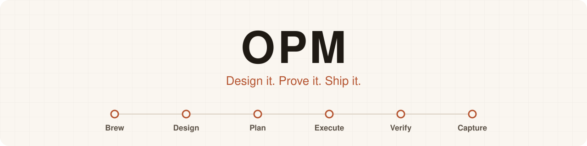
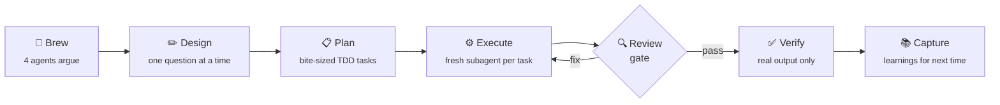

<div align="center">

<picture>
  <source media="(prefers-color-scheme: dark)" srcset="docs/assets/opm-banner-dark.svg">
  <source media="(prefers-color-scheme: light)" srcset="docs/assets/opm-banner-light.svg">
  
</picture>

### A Claude Code plugin for spec-driven, test-first development

[](https://github.com/harshadmadaye/OPM/actions/workflows/ci.yml)
[](https://www.npmjs.com/package/opm-core)
[](LICENSE)
[](https://docs.claude.com/en/docs/claude-code/plugins)
[](docs/why-opm.md#what-opm-costs-per-session)
[](package.json)

[**Install**](#-install) · [**How it works**](#-how-it-works) · [**Try first**](#-three-things-worth-trying-first) · [**What's new**](#-whats-new) · [**Proof**](#-what-opm-can-show) · [**Add-ons**](#-optional-plugins) · [**Reference**](#-everything-in-the-box)

</div>

<br>

OPM adds a full engineering workflow to [Claude Code](https://claude.com/claude-code):
brainstorm a design, write a plan, build it test-first with fresh-context
subagents, review it, and verify it before anything is called done. It
measures what it costs, and CI holds it to that.

```bash
npx opm-core@latest
```

> [!TIP]
> After installing you do not need to remember any command. Every session
> starts with `using-opm` loaded, and it picks the right skill for the job.
> Run `/opm:using-opm` by hand after a long session was compacted, or to see
> the rules. Details: [docs/using-opm.md](docs/using-opm.md).

---

## 🤔 The problem

You open Claude Code and describe what you want. It starts writing. For twenty
minutes this feels like magic.

Then it drifts. It says the tests pass, and it never ran them. It rewrites a
file it already got right. It forgets a decision you made an hour ago, because
that decision is now buried under forty thousand words of conversation.

**Every message you send re-reads the whole conversation.** In hour one that is
cheap. By hour three you pay on every turn to re-read the hour-one chat, and
the model gets worse at its job while the cost climbs.

OPM splits the work. A small main thread holds the plan. Each task goes to a
**fresh worker that sees only that one task** and then disappears. A reviewer
reads every task's diff before the next one starts, nothing is called done
without real command output, and a ledger on disk survives the context being
wiped.

|  | One long chat | OPM |
|---|---|---|
| What the model re-reads each turn | Everything so far | The current task |
| Quality as the day goes on | Drifts | Held by a reviewer gate |
| "Tests pass" | Sometimes a guess | Pasted output, or it does not count |
| If the session resets | Start over | The ledger picks up where it stopped |

---

## 🔁 How it works



1. **Brew** the idea, if it is not settled. Four agents argue, a judge ranks.
2. **Design** it. One question at a time. Nothing is written until you agree the shape.
3. **Plan** it. The spec becomes bite-sized tasks, each with a failing test and a commit.
4. **Execute** it. One fresh subagent per task, a reviewer gate after each.
5. **Verify** it. Build, types, lint, tests, secrets scan. Real output, or it did not happen.
6. **Capture** what was non-obvious, so the next project starts from it.

Every step is a skill you can use on its own. You do not have to run the whole
loop to get value from any one of them.

### Right-sized process

`using-opm` sizes the job first, so you never pay for ceremony a small job does
not need:

| Size | Signal | What runs |
|---|---|---|
| Spike | One file, about 10 lines | `tdd-workflow`. No spec, plan or reviewer |
| Bounded | A feature of a few tasks | `brainstorming`, then `writing-plans` |
| Multi-week | More than about a week or 8 tasks | `milestone-planning` |
| Existing | A project that is already built | `assess` |
| Unattended | A whole new project from one brief | `jump-start` |
| Contested | The idea itself is unsettled | `brew-idea` |

As the job grows, it moves wide searches and reviews to subagents, runs
independent pieces in parallel (in git worktrees when they edit files), and
*offers* a multi-agent run with a rough agent count. It starts that run only
after you say yes. Every step up is announced in one line, so you can stop it.

---

## 🚀 Three things worth trying first

### `/opm:brew-idea`: argue with your idea before you build it

A single AI agrees with you. Brew-idea puts four agents in a room and makes
them fight:

- **Product** asks who this is for, and what nobody actually asked for
- **Engineering** asks what is cheap, what is expensive, and what breaks
- **Skeptic** is paid to attack it: how it fails, what makes it pointless
- **Market** searches the web for who already built this, and says plainly when it could not verify a claim

Every agent has to take a position on every other agent's idea. A judge marks
each feature **keep, improve, add or cut**, with the reason and who argued for
it. A designer turns the verdict into a design page: users, a wireframe per
screen, flows, data, architecture and a phased plan.

```
/opm:brew-idea A field-sales app for our reps: visit planning, GPS check-in,
order capture synced to the ERP.
```

> **The cheapest feature is the one you talked yourself out of building.**

### `/opm:jump-start`: a whole project from one prompt

| Pasting the brief directly | `/opm:jump-start` |
|---|---|
| Starts writing code in the first minute | Asks only about gaps that would change the architecture |
| Picks your stack and data model silently | Shows you a design with flows, wireframes and the data model, then waits |
| Hand-builds every button and dialog | Offers three maintained UI libraries for your stack, and themes the one you pick |
| One context, filling up all day | One fresh subagent per plan, running in parallel waves |
| Tests if you remember to ask | Every task is a failing test first, then code, then a commit |
| "It's done" | Verified, reviewed, then actually started so you can open it |

```
/opm:jump-start my-app A field-sales app for our reps: visit planning, GPS
check-in, order capture synced to our ERP, manager dashboard on web. Android
first, offline capable.
```

It ends by handing you a running app and a URL, or by launching it on a
connected device.

> [!NOTE]
> For the build to run unattended, switch Claude Code to auto mode with
> Shift+Tab when it asks. OPM never changes your permission mode itself.

### `/opm:assess`: a verified report on code you already have

```
/opm:assess code src/
```

Pick a level: architecture, code, one feature or the whole project. It maps the
repo, runs the baseline gates read-only, sends parallel reviewers through it,
and has a verifier re-check every cited line before anything is reported.
Findings get IDs, a severity and an effort, and land in
`docs/assessments/YYYY-MM-DD-<level>.md`. A later run marks each one Fixed, New
or Still open.

Then you choose which bundles to fix. Small ones go straight to `tdd-workflow`,
bigger ones to a plan, and anything over 8 tasks to a milestone. Publishing the
report, creating the fix branch and committing each ask first. Secret values
are never quoted.

---

## ✨ What's new

**Unreleased: UI library choice.** New projects with a UI now pick a component
library instead of hand-building every component. `jump-start` and
`brainstorming` search once for maintained, OSI-licensed libraries that fit the
stack and ask one question: the top three (best one marked Recommended), or
custom components, or name your own. If search is unavailable they fall back to
known lists (Web/React: shadcn/ui, Mantine, MUI; Flutter: Material 3,
shadcn_ui, Forui). The foundation installs the library and wires the design
tokens into its theme. The question is skipped when the brief names a library,
one is already installed, or there is no UI.

**0.11: `opm:assess` and the `opm-design` add-on.** Assess existing projects
(above). The `code-reviewer` and `typescript-reviewer` agents gain a Sweep mode
for whole files. [`opm-design`](#-opm-design-direction-flows-and-a-second-pair-of-eyes-for-ui)
adds design direction, flows and visual QA.

**0.10: long runs keep you in the loop.** Human checks stay human, each phase
closes with a review pack, and evidence says where it ran.
[See below](#-long-runs-keep-you-in-the-loop).

Full history: [CHANGELOG.md](CHANGELOG.md).

---

## 📏 What OPM can show

Four claims, each with its evidence. Token counts are bytes / 4 estimates from
`npm run tokens`.

**1. It costs 2,648 tokens per session.** That is every skill and agent
description, plus the `using-opm` skill injected at session start. The rules
add 1,401 tokens in repos that install them. CI fails if either grows past its
ceiling (2,650 and 1,550). Evidence: [the cost table](docs/why-opm.md#what-opm-costs-per-session).
You can also check with `claude plugin details opm`.

**2. Big skills load a small core.** A skill costs nothing until it runs. Split
skills then load only their core; the `references/` files load when a step
needs them.

| Skill | Core, per run (tokens) | References, on demand (bytes) |
|---|--:|--:|
| `executing-plans` | 1,056 | 21,227 |
| `assess` | 1,106 | 10,981 |
| `flutter-patterns` | 903 | 10,754 |
| `python-patterns` | 797 | 10,166 |
| `react-patterns` | 876 | 8,849 |
| `verification-before-completion` | 1,406 | 6,703 |

The largest unsplit skill, `tdd-workflow`, loads 2,784 tokens.

**3. CI runs on macOS, Linux and Windows, with Node 18, 20 and 22.** Nine test
jobs, then a gate that validates the manifests with the Claude Code CLI.
Evidence: [CI](https://github.com/harshadmadaye/OPM/actions/workflows/ci.yml).

**4. Status and safety cost no model turn, on Claude Code 2.1.287 or later.**
`/opm-status`, `/opm-status --all` and `/opm-report` are answered by code. The
destructive-command hold and the hook-bypass checks run as code before a tool
call. Evidence: [Mod features](#-mod-features-claude-code-21287-or-later) and
[docs/threat-model.md](docs/threat-model.md).

> [!IMPORTANT]
> What OPM **cannot** show yet, such as the cost of a whole task, is listed in
> [docs/why-opm.md](docs/why-opm.md#what-we-can-and-cannot-show-yet). The mod
> features are tested with the Claude Code test kit in CI, not yet in a live
> session. The behaviour and trigger evals are written but **have not been
> run** ([docs/evals.md](docs/evals.md)).

---

## 🛡️ Long runs keep you in the loop

<details>
<summary><b>Unattended runs cannot finish with nobody having read the risky code</b> (since 0.10)</summary>

<br>

- **Human checks stay human.** In an unattended run a `checkpoint:human-verify`
  goes to `REVIEW-QUEUE.md` with its evidence and the run carries on. The agent
  never marks it passed. `STATE.md` reads "complete, N human checks pending"
  until you empty the queue.
- **A review pack at each phase close.** `REVIEW-PACK.md` ranks the five riskiest
  changes (auth, permissions, data deletion, migrations, payments, sync,
  secrets, external calls), each with its diff range and a few "explain how X
  handles Y" questions. About 20-30 minutes of reading.
- **You choose the cadence.** After each phase (the default) or only at the end.
  "Only at the end" shows the expected commit count and is logged as a decision.
- **What stops a run is short and the same everywhere.** Four stop conditions
  (an exposed secret stops it at once), steps only you can do, and the cadence
  pause. In unattended runs an architecture change is ruled, logged and queued
  for review. An agent that reports success with no new commits is rerun once,
  then escalated, never marked complete.
- **Evidence says where it ran.** Each check is labelled
  `env: unit | simulator | physical-device | prod-like`. A performance, startup,
  battery or network claim from a simulator reads NOT JUDGEABLE.
- **Reviewers state confidence and the line they cite**, and final reports
  count findings by severity and by fixed, parked or dismissed.

`npx opm-core status --report` prints the outcome from the ledgers and
milestone files: tasks done, findings by severity, fix rounds, items parked,
human checks pending, issues opened and closed, rulings made.

</details>

---

## 📦 Install

```bash
npx opm-core@latest
```

That installs the plugin and copies the coding rules into your repo. Options:

```bash
npx opm-core@latest --rules typescript,react   # no questions
npx opm-core@latest --plugin-only              # skip the rules
npx opm-core@latest --rules-only ../other-repo # rules for another repo
```

Or the native route, two commands:

```bash
claude plugin marketplace add harshadmadaye/OPM
claude plugin install opm@opm
```

Check an install with `npx opm-core doctor`. It checks Node, Claude Code, the
plugin, whether the copied rules are current and the tools the hooks call, and
replays each hook offline. It exits 1 only when a check fails.

<details>
<summary><b>Rules, upgrades and troubleshooting</b></summary>

<br>

The rules are plain markdown that Claude Code loads from
`<repo>/.claude/rules/opm/`. A plugin cannot ship them, which is why they are
copied per repository. Keep `common/` small: it loads in every session.

- **Upgrading from an older install?** Run `claude plugin marketplace remove opm`
  first, otherwise you keep pulling from wherever it pointed before.
- **`/opm:` commands not recognised?** Run `/reload-plugins`.
- **Git reaches GitHub over SSH and that fails?** Set `CLAUDE_CODE_PLUGIN_PREFER_HTTPS=1`.

This repository is public, so no GitHub credentials are needed.

</details>

**Platforms.** Node 18 or later. The installer, hooks and tests run on macOS,
Linux and Windows. `scripts/dev-server.sh` and `scripts/install-rules.sh` are
shell scripts (macOS, Linux and WSL only). Tested with Claude Code
2.1.273 - 2.1.289; the mod features need 2.1.287 or later, and
`npx opm-core doctor` tells you whether yours has them.

> [!NOTE]
> Nothing here phones home and nothing runs a model behind your back.

---

## 🧩 Optional plugins

Two add-ons sit in the same marketplace. They are kept out of `opm` so the core
stays small and ships no video or browser toolchain.

### 🎨 `opm-design`: direction, flows and a second pair of eyes for UI

AI-built UI tends to look the same: purple gradients, three identical cards,
centred everything, and buttons with no focus state. `opm-design` makes Claude
set a direction before writing UI code, holds every build to a written craft
floor (contrast, focus, motion, tap targets, no invented stats), and then
checks the result by looking at it.

```
/opm-design:frontend-design   build or redesign a page or component
/opm-design:design-system     create or extract a validated DESIGN.md
/opm-design:ux-flows          use cases, Mermaid flows and a screen inventory before any screen
```

- **Visual QA** screenshots the page at phone and desktop widths, checks for
  horizontal scroll down to 320px, collects console errors and runs axe-core.
  An independent `design-reviewer` agent that never saw the build reasoning
  answers `ship`, `fix`, `rebuild` or `recapture`.
- **Rules have IDs** (`F-01` contrast, `R-01` gradients). Floor rules are never
  waived. AI-default "reflexes" can be kept only with a written waiver that
  cites evidence.
- **Uses your UI library.** When a component library is installed, it builds
  with it instead of hand-rolling components.
- **Flows before screens.** `ux-flows` waits for your approval of the use cases,
  then checks the screen inventory for dead ends and orphans.

```bash
claude plugin install opm-design@opm
```

Visual QA uses your project's own Playwright if it has one. Otherwise it
**asks before downloading** pinned Playwright, axe-core and Chromium (about
150 MB) into `~/.opm/design-tools`. Say no and you get a manual checklist
instead. Web first; Flutter gets the token mapping and the rules, but no visual
QA yet.

### 🎬 `opm-video`: turn a spec into a narrated video

Point it at a spec, a brew-idea result, or any document. You get a 1920x1080
MP4 with a neural voice-over and subtitles, plus the editable storyboard and
slides. It is a narrated slideshow with fades, not animation.

```
/opm-video:explainer-video docs/specs/2026-09-17-field-sales-brew.md
```

The first version had an AI draw every slide: fourteen slides cost about
**190,000 tokens, 77 tool calls and 22 minutes.** Slides are now rendered by a
script from a kit of nine layouts and 24 icons, so **drawing them costs no AI
tokens.** What remains is writing the storyboard, which needs judgement.

| | Hand-drawn by AI | Layout kit |
|---|---|---|
| Who draws the slides | An AI, one at a time | A script, all at once |
| Tokens to draw them | ~190,000 | none |
| Reviewing the result | 14 images, one by one | one contact sheet |
| Changing one word | redraw the slide | re-render; only that scene rebuilds |

Every fact in the video has to trace back to the source document, and a
validator enforces it.

```bash
claude plugin install opm-video@opm
```

It needs a headless browser (Chrome, Chromium, Edge or Brave, or `CHROME_PATH`),
and on first build installs pinned ffmpeg, ffprobe and edge-tts into
`~/.opm/explainer-video-tools`. Python is needed for the neural voice.

> [!WARNING]
> The neural voice sends the narration text to Microsoft's cloud speech service
> through edge-tts. It asks first, and offers the local OS voice so nothing
> leaves your machine.

---

## ⚡ Mod features (Claude Code 2.1.287 or later)

OPM ships a small hooks module (a "mod") beside its settings hooks. It answers
some things from code, so they cost no Claude turn and no tokens. Older Claude
Code ignores the module and keeps running every settings hook, so nothing
breaks; you just do not get the extras.

| Feature | What it does | On older Claude Code |
|---|---|---|
| `/opm-status` | Prints the open plan ledger (tasks done, current task, last ruling), the milestone position and the git branch. | `npx opm-core status` prints the same on any version. |
| `/opm-status --all` | Lists every open OPM plan on this machine, newest first (at most 25 rows). Rows older than 3 days are marked "(stale)"; snapshots are pruned after 14 days. | Run `npx opm-core status` in each repo. |
| Resume line | When a plan ledger is open, session start adds one line naming it and the next task. | Works on every version. |
| Destructive-command hold | Asks before `rm -rf` on a root-like or out-of-repo path, a force-push to `main` or `master`, or `git reset --hard`. Anything but "Run it" denies. `OPM_GUARD=off` turns it off. | Not available. The settings hooks still block hook bypasses. |
| Hook-bypass and config checks | The `block-no-verify` and `config-protection` checks, run in process from one shared rules module, so each check runs once. | The settings hooks run the same checks. |
| `/opm-report` | Opt-in token meter, off by default (`--enable` / `--disable`). Keeps 14 days locally in one store key capped at 256 KiB. Nothing is sent anywhere. | Not available. |

Commands use a hyphen (`/opm-status`, not `/opm:status`). Output is plain text,
so it also works in the VS Code chat panel.

<details>
<summary><b>What the mod declares</b>, from <code>claude plugin validate --strict</code> (review it before you install)</summary>

<br>

| | Declared |
|---|---|
| Events | `session.start`, `command.run` (`opm-status`, `opm-report`), `tool.call` (Bash, Edit, Write), `skill.prompt`, `turn.complete` (one with `isAborted=false`, one unmatched) |
| Calls | `$.clock.now`, `$.command.register`, `$.env.get`, `$.env.set`, `$.fs.exists`, `$.fs.list`, `$.fs.read`, `$.fs.stat`, `$.process.run` (via `currentBranch`), `$.session.cwd`, `$.session.id`, `$.session.root`, `$.store.delete`, `$.store.get`, `$.store.keys`, `$.store.set`, `$.ui.ask`, `$.ui.log` |
| Environment | reads `OPM_ALLOW_CONFIG_EDITS`, `OPM_GUARD`, `OPM_HOOKS_DISABLED`; writes `OPM_MOD_ACTIVE` |

No network calls and no model calls.

</details>

---

## 🗂️ Everything in the box

<details>
<summary><b>All 14 skills</b>: invoked as <code>/opm:&lt;name&gt;</code>, or picked up automatically when they match the task</summary>

<br>

**The loop**

| Skill | What it does |
|---|---|
| `using-opm` | Injected at session start. Sizes the job, picks the skill, and scales up to subagents, parallel work, plans or an offered multi-agent run as the job grows. See [docs/using-opm.md](docs/using-opm.md). |
| `brew-idea` | Four agents argue the idea from product, engineering, skeptic and market angles; a judge ranks features. |
| `brainstorming` | No code before the design is agreed. One question at a time, scaled to the size of the job. Asks which UI library to use for new projects with a UI. |
| `writing-plans` | Turns an approved spec into bite-sized tasks, each with a failing test, implementation and commit. |
| `executing-plans` | Runs a plan with one fresh subagent per task and a reviewer gate after each. Ledger survives compaction. |
| `verification-before-completion` | No "done", "fixed" or "passing" without fresh command output. A full gate (build, types, lint, tests, secrets scan, diff review) runs before a PR or release. |
| `compound-learnings` | Captures non-obvious fixes as short docs, and reads them back before planning. |

**Bigger scope**

| Skill | What it does |
|---|---|
| `milestone-planning` | Multi-week work: roadmap, short STATE digest, phased plans with wave scheduling for parallel subagents. |
| `jump-start` | A whole project from one prompt, including the UI library choice and its theme. |
| `assess` | Assesses an existing project (architecture, code, one feature or the whole project), verifies every finding, writes a ranked report, then routes the fixes you choose into the plan and TDD skills on a fix branch. |

**Engineering**

| Skill | What it does |
|---|---|
| `tdd-workflow` | Strict red, green, refactor with a "fails for the right reason" gate and an evidence report. |

**Stack patterns**

| Skill | What it does |
|---|---|
| `react-patterns` | React 18/19 and Next.js App Router: hooks discipline, server and client boundaries, measured performance work. Theme and wrap a UI library, never fork it. |
| `python-patterns` | Modern Python: typing, dataclasses and pydantic at boundaries, async basics, uv, ruff and pytest layout. |
| `flutter-patterns` | Flutter and Dart 3: widget composition, state management choice, async and streams, Firebase, tests. |

</details>

<details>
<summary><b>5 reviewer subagents</b>: dispatched automatically when a task matches, or ask for one by name</summary>

<br>

| Agent | Model | Use it for |
|---|---|---|
| `planner` | opus | Turning an agreed spec into an implementation plan |
| `code-reviewer` | sonnet | Diff review with a confidence gate and an explicit false-positive list; Sweep mode reviews whole files |
| `typescript-reviewer` | sonnet | TypeScript and Node specifics: types, async pitfalls, merge readiness; Sweep mode reviews whole files |
| `security-reviewer` | sonnet | OWASP checks, dependency audits for npm, Python and Dart, Firebase rules |
| `silent-failure-hunter` | sonnet | Swallowed errors, empty catches, misleading fallbacks |

</details>

<details>
<summary><b>6 safety hooks</b>: dependency-free scripts that never call a model or the network</summary>

<br>

| Event | Effect |
|---|---|
| SessionStart | Injects the workflow map on startup, `/clear` and compaction |
| PreToolUse on Bash | Denies `git commit --no-verify` and other hook bypasses |
| PreToolUse on Edit/Write | Asks before editing lint, format, typecheck or `.husky` config |
| PostToolUse on Edit/Write | Records edited files for the Stop hooks |
| Stop | Formats edited files in projects that configure prettier or ruff (dart always), runs tsc, ruff or dart, blocks on type errors |
| Stop | Warns about leftover `console.log`, `print` or `debugPrint` |

Set `OPM_HOOKS_DISABLED=1` to turn them all off. Per-hook switches are
`OPM_ALLOW_CONFIG_EDITS`, `OPM_SKIP_FORMAT` and `OPM_SKIP_TYPECHECK`; see
[hooks/README.md](hooks/README.md). The hooks are guard rails, not a security
boundary: [docs/threat-model.md](docs/threat-model.md) lists what they block,
what they let through on purpose, and what is out of scope.

</details>

<details>
<summary><b>Behaviour evals</b>: authored, not yet run</summary>

<br>

Six evals under `evals/` check OPM's own rules on small sample repos: stops on
an architecture change, refuses "done" without fresh output, ignores a mid-run
chat message, queues human checks, skips ledger-complete tasks, no push without
a yes. They are paid, so they run by hand with
`npm run eval:behaviour -- --yes`, and **they have not been run**: OPM's
behaviour under them is unmeasured. The trigger evals (core and `--suite design`)
have not been run either. See [docs/evals.md](docs/evals.md).

</details>

<details>
<summary><b>Repository layout</b></summary>

<br>

```
.claude-plugin/   plugin.json, marketplace.json
agents/           5 subagents
skills/           14 skills (SKILL.md plus templates/scripts where needed)
plugins/          opm-video and opm-design, the optional add-on plugins
hooks/            hooks.json, 6 dependency-free Node scripts and mod/ (the hooks module)
rules/            copied into <repo>/.claude/rules/opm/ by the installer
bin/              the npx installer
scripts/          install-rules.sh, dev-server.sh
tests/            node --test tests/*.test.js
evals/            behaviour and trigger evals (run by hand)
docs/             specs, plans, design notes and assets
```

</details>

---

## 🤝 Contributing

See [CONTRIBUTING.md](CONTRIBUTING.md) for setup, the rules the tests enforce,
and how to open a pull request. By taking part you agree to the
[Code of Conduct](CODE_OF_CONDUCT.md).

## 📄 Licence

MIT. See [LICENSE](LICENSE).
