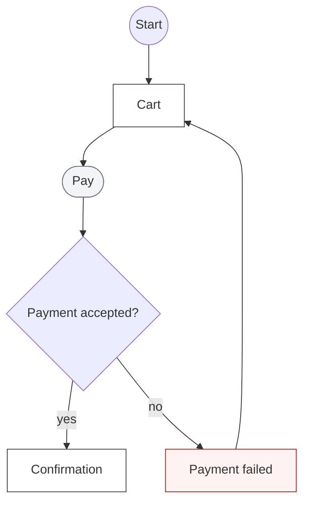
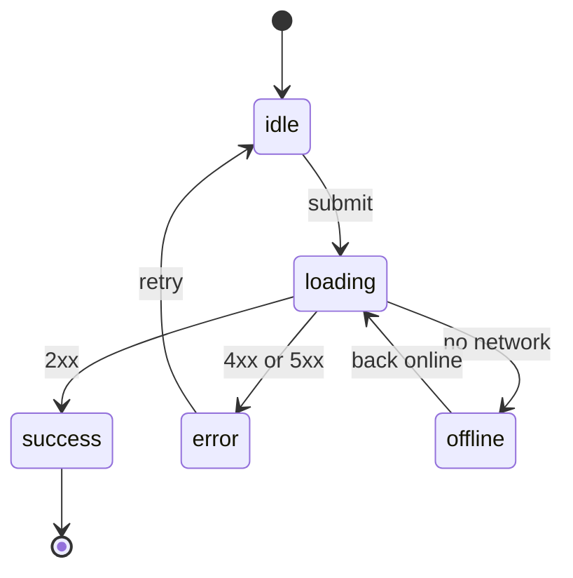
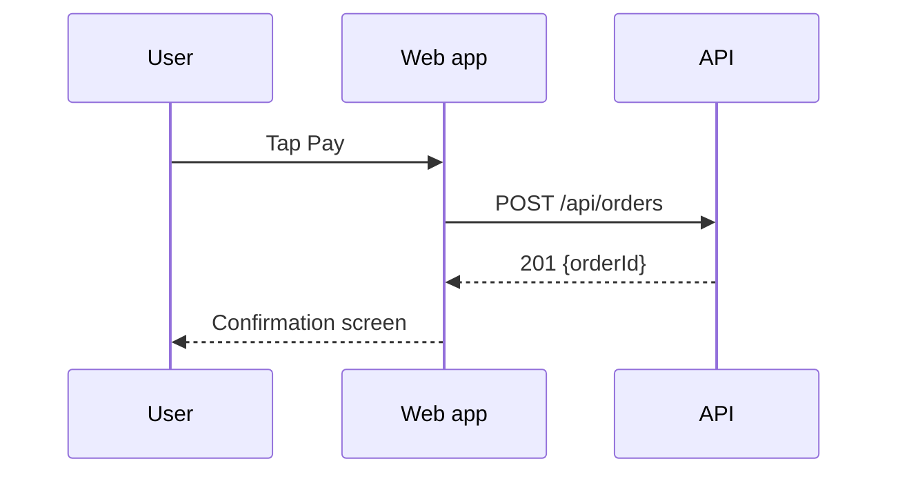

# opm-design Implementation Plan

> **For agentic workers:** REQUIRED SUB-SKILL: Use opm:executing-plans to implement this plan task-by-task. Each task follows opm:tdd-workflow. Steps use checkbox (`- [ ]`) syntax for tracking.

**Goal:** Ship `opm-design`, an optional sub-plugin with three skills (`frontend-design`, `design-system`, `ux-flows`), a `design-reviewer` agent, one shared craft-floor rules file, and zero-dependency Node scripts for contrast, DESIGN.md validation, flow checks and visual QA.

**Architecture:** A new plugin at `plugins/opm-design`, listed in the `opm` marketplace beside `opm-video`. Every skill and the agent cite rules by ID from `shared/craft-floor.md`. Scripts are ES modules with no package dependencies. Playwright and axe-core are loaded only if they are already present or the user agrees to a pinned install in `~/.opm/design-tools/`. Core OPM gets one pointer line in `using-opm`, one line in the full-gate reference, and token-budget reporting for the add-on.

**Tech Stack:** Node >= 18 ES modules (`.mjs`), `node --test` (CommonJS test files), Markdown skills, Mermaid in generated docs, optional Playwright 1.48.2 and axe-core 4.10.2.

**Spec:** `docs/specs/2026-11-03-opm-design.md`

## Global Constraints

- Node >= 18. Zero package dependencies; `plugins/opm-design` has no `package.json` and no `node_modules`.
- Scripts are ES modules (`.mjs`). Tests are CommonJS files in `tests/` (`'use strict'`, `require`), named `tests/design-*.test.js`, and load scripts with `await import(pathToFileURL(file).href)`, because a bare Windows path is not a valid import specifier.
- Tests run in CI on macOS, Linux and Windows with Node 18, 20 and 22: build paths with `path.join`, spawn scripts with `process.execPath`, and never rely on a shell glob.
- Tests never launch a browser and never touch the network except loopback.
- Each opm-design `SKILL.md` stays under 1,200 tokens (4,800 bytes including frontmatter). Core always-on context stays under 2,650 tokens (`npm run tokens`).
- `plugins/opm-design/.claude-plugin/plugin.json` and its marketplace entry carry the core version (`0.10.0` today); `tests/manifest.test.js` enforces this.
- Visual-QA screenshots and reports go to the scratchpad or the OS temp folder, never inside the project.
- Pinned optional tools: `playwright@1.48.2`, `axe-core@4.10.2`, installed only after an explicit yes, into `~/.opm/design-tools/`.
- Violations print as one line each: `Violation: <rule>. Fix: <action>.`
- Apache-2.0 sources (impeccable, stitch-skills, anthropics/skills) are never copied. Their ideas are re-expressed in OPM's own words and credited in `THIRD_PARTY_NOTICES.md`.
- Commits use Conventional Commits and end with `Co-Authored-By: Claude Opus 5.5 <noreply@anthropic.com>`. Never `--no-verify`.
- Run one test file with `node --test tests/<name>.test.js`. Run everything with `npm test`.

## Spec clarifications made by this plan

The spec is approved. The points below fill gaps it left open. A reviewer should check them first.

1. **DESIGN.md frontmatter is a YAML subset**: nested maps with 2-space indents, scalar values, and hex values in quotes. The validator stays zero-dependency, and every valid file is still valid YAML.
2. **Tool ladder order:** `OPM_DESIGN_TOOLS`, then the project's own Playwright, then an earlier consented install in `~/.opm/design-tools/`, then `--mcp`, then `--install` (after a yes), then manual. A missing install exits with code 2 so the skill knows to ask first.
3. **F-05 is checked at 320px.** Screenshots are taken at 375×812 and 1280×800 as the spec says, and the script also measures horizontal overflow at 320px width without a screenshot.
4. **`contrast.mjs` also exports `deltaE76`** (CIE76), which the design-system extract mode needs to merge colours closer than ΔE 3.
5. **Rule IDs:** finish rules are `N-01`..`N-05` and optional presets are `P-01`..`P-03`. Every rule is a table row so the lint test can parse it.
6. **The reviewer gets the diff as a file** (`<out-dir>/change.diff`), so its Bash use stays limited to `visual-qa.mjs`.
7. **Trigger eval gains `--suite design`**, which reads `tests/fixtures/design-trigger-prompts.json` and loads both plugin directories. It is paid, so it is never run in CI.
8. **`npm run tokens` measures add-ons in `plugins/opm-design`** and enforces the 1,200-token cap on their skills as a failure, not a warning.

## File map

```
plugins/opm-design/
  .claude-plugin/plugin.json                         Task 1
  shared/craft-floor.md                              Task 2
  shared/is-main.mjs                                 Task 3
  skills/frontend-design/scripts/contrast.mjs        Task 3
  skills/design-system/scripts/validate-design-md.mjs Task 4
  skills/ux-flows/scripts/check-flows.mjs            Task 5
  skills/frontend-design/scripts/visual-qa.mjs       Task 6
  skills/frontend-design/scripts/lib/tool-ladder.mjs Task 6
  skills/frontend-design/scripts/lib/install.mjs     Task 6
  skills/frontend-design/scripts/lib/capture.mjs     Task 6
  skills/frontend-design/scripts/lib/design-contrast.mjs Task 6
  skills/design-system/SKILL.md + references/*       Task 7
  skills/frontend-design/SKILL.md + references/*     Task 8
  skills/ux-flows/SKILL.md + references/*            Task 9
  agents/design-reviewer.md                          Task 10
scripts/token-budget.js                              Task 11
scripts/evals/trigger-eval.js, tests/fixtures/design-trigger-prompts.json  Task 12
.claude-plugin/marketplace.json                      Task 1
skills/using-opm/SKILL.md, skills/verification-before-completion/references/full-loop.md,
README.md, docs/marketplace-listing.md, THIRD_PARTY_NOTICES.md, CHANGELOG.md        Task 13
tests/design-*.test.js, tests/manifest.test.js, tests/package-contents.test.js,
tests/token-budget.test.js, tests/trigger-eval.test.js
```

---

### Task 1: Plugin scaffold and marketplace entry

**Files:**
- Create: `plugins/opm-design/.claude-plugin/plugin.json`
- Modify: `.claude-plugin/marketplace.json`
- Test: `tests/manifest.test.js` (modify the marketplace test, add one test)

**Interfaces:**
- Consumes: nothing.
- Produces: plugin name `opm-design`, source `./plugins/opm-design`, and the plugin directory that later tasks fill.

- [ ] **Step 1: Write the failing test**

In `tests/manifest.test.js`, replace the test `'the marketplace lists core and the optional opm-video plugin, and only opm-video ships explainer-video'` with this version, and add the new test after it:

```js
test('the marketplace lists core and the optional opm-video and opm-design plugins, and only opm-video ships explainer-video', () => {
  const marketplace = read('.claude-plugin/marketplace.json');
  assert.deepEqual(marketplace.plugins.map((p) => [p.name, p.source]), [
    ['opm', './'],
    ['opm-video', './plugins/opm-video'],
    ['opm-design', './plugins/opm-design'],
  ]);
  const video = read('plugins/opm-video/.claude-plugin/plugin.json');
  assert.equal(video.name, 'opm-video');
  assert.equal(video.version, read('.claude-plugin/plugin.json').version);
  assert.match(video.description, /Microsoft cloud/, 'opm-video must disclose the cloud text-to-speech route');
  assert.ok(fs.existsSync(path.join(ROOT, 'plugins', 'opm-video', 'skills', 'explainer-video', 'SKILL.md')));
  assert.ok(!fs.existsSync(path.join(ROOT, 'skills', 'explainer-video')), 'core must not register explainer-video');
});

test('opm-design is on the core version and discloses its consented download', () => {
  const design = read('plugins/opm-design/.claude-plugin/plugin.json');
  assert.equal(design.name, 'opm-design');
  assert.equal(design.version, read('.claude-plugin/plugin.json').version);
  for (const text of [design.description, read('.claude-plugin/marketplace.json').plugins.find((p) => p.name === 'opm-design').description]) {
    assert.match(text, /asks before/, 'opm-design must say it asks before downloading');
    assert.match(text, /150 MB/, 'opm-design must state the download size');
    assert.match(text, /~\/\.opm\/design-tools/, 'opm-design must name the install folder');
  }
  for (const core of ['frontend-design', 'design-system', 'ux-flows']) {
    assert.ok(!fs.existsSync(path.join(ROOT, 'skills', core)), `core must not register ${core}`);
  }
});
```

- [ ] **Step 2: Run the test to verify it fails**

Run: `node --test tests/manifest.test.js`
Expected: FAIL. The deepEqual shows the missing `opm-design` entry, and the new test fails with ENOENT on `plugins/opm-design/.claude-plugin/plugin.json`.

- [ ] **Step 3: Write the minimal implementation**

Create `plugins/opm-design/.claude-plugin/plugin.json`:

```json
{
  "name": "opm-design",
  "displayName": "OPM Design",
  "version": "0.10.0",
  "description": "Optional OPM add-on: a design workflow for UI work. Sets a direction and a quality floor before code, keeps a validated DESIGN.md design system, maps user flows before screens, and checks the build with screenshots and an independent design reviewer. Visual QA uses the project's own Playwright when present; otherwise it asks before downloading pinned Playwright, axe-core and Chromium (about 150 MB) into ~/.opm/design-tools, and falls back to a manual checklist on a no.",
  "author": {
    "name": "Harshad Madaye",
    "url": "https://github.com/harshadmadaye"
  },
  "repository": "https://github.com/harshadmadaye/OPM",
  "license": "MIT",
  "keywords": [
    "claude-code",
    "design-system",
    "ux-flows",
    "accessibility",
    "visual-qa"
  ],
  "homepage": "https://github.com/harshadmadaye/OPM"
}
```

In `.claude-plugin/marketplace.json`, change `metadata.description` to:

```json
"description": "Marketplace for the OPM engineering workflow plugin for Claude Code and its optional explainer-video and design add-ons"
```

and append this entry to `plugins`, after `opm-video`:

```json
{
  "name": "opm-design",
  "source": "./plugins/opm-design",
  "description": "Optional add-on: design direction and a quality floor before UI code, a validated DESIGN.md, user-flow maps, and visual QA with screenshots and an independent reviewer. Uses the project's Playwright when present; otherwise it asks before downloading Playwright, axe-core and Chromium (about 150 MB) into ~/.opm/design-tools.",
  "version": "0.10.0",
  "author": {
    "name": "Harshad Madaye",
    "url": "https://github.com/harshadmadaye"
  }
}
```

- [ ] **Step 4: Run the tests to verify they pass**

Run: `node --test tests/manifest.test.js`
Expected: PASS, all tests.

If the `claude` CLI is installed, also run `claude plugin validate --strict .` and expect success. If it is not installed, say so in the task report; CI runs the check.

- [ ] **Step 5: Commit**

```bash
git add plugins/opm-design/.claude-plugin/plugin.json .claude-plugin/marketplace.json tests/manifest.test.js
git commit -m "feat(opm-design): scaffold the plugin and list it in the marketplace"
```

---

### Task 2: Craft floor rules and their lint

**Files:**
- Create: `plugins/opm-design/shared/craft-floor.md`
- Test: `tests/design-craft-floor.test.js`

**Interfaces:**
- Consumes: the plugin directory from Task 1.
- Produces: rule IDs `F-01`..`F-10`, `R-01`..`R-10`, `N-01`..`N-05` and `P-01`..`P-03`, each defined as a table row that starts `| <ID> |`. The waiver line format is `- <ID> | <evidence> | <reason>`. The lint test scans every `.md` file under `plugins/opm-design`, so citations added by later tasks are checked automatically.

- [ ] **Step 1: Write the failing test**

Create `tests/design-craft-floor.test.js`:

```js
'use strict';
// Craft floor lint: unique rule IDs, and every cited ID exists. Run with: node --test tests/design-craft-floor.test.js
const test = require('node:test');
const assert = require('node:assert/strict');
const fs = require('node:fs');
const path = require('node:path');

const PLUGIN = path.resolve(__dirname, '..', 'plugins', 'opm-design');
const FLOOR = path.join(PLUGIN, 'shared', 'craft-floor.md');
const DEFINITION = /^\| ([FRNP]-\d{2}) \|/gm;
const CITATION = /\b([FRNP]-\d{2})\b/g;

function markdownFiles(dir) {
  return fs.readdirSync(dir, { withFileTypes: true }).flatMap((entry) => {
    const full = path.join(dir, entry.name);
    if (entry.isDirectory()) return markdownFiles(full);
    return entry.name.endsWith('.md') ? [full] : [];
  });
}

const definedIds = () => [...fs.readFileSync(FLOOR, 'utf8').matchAll(DEFINITION)].map((m) => m[1]);
const range = (prefix, count) => Array.from({ length: count }, (_, i) => `${prefix}-${String(i + 1).padStart(2, '0')}`);

test('every craft floor rule has a unique ID', () => {
  const ids = definedIds();
  const duplicates = ids.filter((id, i) => ids.indexOf(id) !== i);
  assert.deepEqual(duplicates, [], `duplicate rule IDs: ${duplicates.join(', ')}`);
});

test('the floor, reflex, finish and preset sets are complete', () => {
  const ids = new Set(definedIds());
  for (const id of [...range('F', 10), ...range('R', 10), ...range('N', 5), ...range('P', 3)]) {
    assert.ok(ids.has(id), `${id} is not defined in craft-floor.md`);
  }
});

test('every rule ID cited anywhere in opm-design exists', () => {
  const ids = new Set(definedIds());
  for (const file of markdownFiles(PLUGIN)) {
    const cited = [...fs.readFileSync(file, 'utf8').matchAll(CITATION)].map((m) => m[1]);
    const unknown = [...new Set(cited.filter((id) => !ids.has(id)))];
    assert.deepEqual(unknown, [], `${path.relative(PLUGIN, file)} cites unknown rules: ${unknown.join(', ')}`);
  }
});

test('the craft floor states the waiver format and its limits', () => {
  const text = fs.readFileSync(FLOOR, 'utf8');
  assert.ok(text.includes('- <ID> | <evidence> | <reason>'), 'waiver line format missing');
  assert.match(text, /at least 24 characters/);
  assert.match(text, /Design waivers/);
  assert.match(text, /never waived/i);
});
```

- [ ] **Step 2: Run the test to verify it fails**

Run: `node --test tests/design-craft-floor.test.js`
Expected: FAIL with ENOENT for `shared/craft-floor.md`.

- [ ] **Step 3: Write the minimal implementation**

Create `plugins/opm-design/shared/craft-floor.md`:

```markdown
# Craft floor

The one rules file for opm-design. Skills and the design-reviewer agent cite rules by ID and
never restate them. Three tiers: Floor rules are never waived, Reflex rules need a recorded
waiver, Finish rules are craft notes that never block.

## Floor (F): never waived

| ID | Rule | How to check |
|---|---|---|
| F-01 | Body text contrast at least 4.5:1; large text (24px, or 18.66px bold) and UI components at least 3:1 (WCAG 2.2 AA) | `contrast.mjs <fg> <bg>`; axe `color-contrast` |
| F-02 | Every interactive element has a visible `:focus-visible` style | Tab through the page; no `outline: none` without a replacement |
| F-03 | Motion respects `prefers-reduced-motion` | Every animation or transition over 200ms has a reduced-motion branch |
| F-04 | Tap targets at least 44×44 CSS px | Measure buttons, links in lists, icon buttons |
| F-05 | No horizontal scroll at 320px width | `horizontalOverflow["320"]` in the visual-QA report is false |
| F-06 | No invented facts, statistics, logos or testimonials; use `[metric]`-style placeholders | Every number, name and quote traces to the user or the codebase |
| F-07 | No fake send: a success state shows only after a real response | Success UI is set in the response handler, not on click |
| F-08 | Meaningful images have alt text; decorative images have empty alt | axe `image-alt`; read each `` |
| F-09 | Every form field has a programmatic label | `<label for>`, `aria-label` or `aria-labelledby`; placeholder is not a label |
| F-10 | No hard-coded colours where a `DESIGN.md` token exists | Grep the diff for hex, `rgb(` and `hsl(` |

## Reflex (R): AI defaults, waivable only with a recorded waiver

| ID | Reflex | Do instead |
|---|---|---|
| R-01 | Purple-to-blue or rainbow gradients | A flat brand colour, or a gradient within one hue |
| R-02 | A card nested in a card | One container; separate inner groups with spacing or a divider |
| R-03 | Emoji used as icons | An icon set, or no icon |
| R-04 | An eyebrow label above every heading | Only where the label adds information |
| R-05 | `transition: all` | Name the properties: `transition: opacity 150ms, transform 150ms` |
| R-06 | `h-screen` or `100vh` for full-height layouts | `100dvh` (`h-dvh` in Tailwind) |
| R-07 | Filler copy: "seamless", "robust", "elevate", "empower", a bare "Get started" or "Learn more" | Say what happens: "Create your first invoice" |
| R-08 | Everything centred | Left-align body copy and forms; centre only short display text |
| R-09 | Three identical feature cards | Vary by content: one lead item, a list, a comparison |
| R-10 | A gradient-text hero headline | Solid text; put emphasis in the words |

### Waivers

A reflex kept on purpose needs one waiver line in a `Design waivers` section of the PR
description or task report:

    - <ID> | <evidence> | <reason>

- `<ID>` is one reflex rule (R-*). Floor rules are never waived.
- `<evidence>` is a `file:line` or a screenshot path.
- `<reason>` is at least 24 characters, specific to this product, not boilerplate ("design
  choice", "looks better", "per request") and not copied word for word from another waiver.

Example: `- R-01 | src/Hero.tsx:12 | Brand guide v3 requires the violet-to-indigo hero band.`

## Finish (N): craft, never blocks

| ID | Note |
|---|---|
| N-01 | Type sizes follow one scale with a steady ratio; no one-off sizes |
| N-02 | Spacing comes from the token scale; no one-off margins |
| N-03 | One radius family; nested corners use outer radius minus padding |
| N-04 | Optical alignment: icons and text line up by eye, not only by box |
| N-05 | Body copy line length is 45-80 characters |

## Optional presets (P): only when the user picks the preset

| ID | Preset rule |
|---|---|
| P-01 | Editorial restraint: no serif display faces; one sans family throughout |
| P-02 | No tracked-out uppercase labels |
| P-03 | No cream or beige page backgrounds; pure white or a neutral grey surface |
```

- [ ] **Step 4: Run the test to verify it passes**

Run: `node --test tests/design-craft-floor.test.js`
Expected: PASS, 4 tests.

- [ ] **Step 5: Commit**

```bash
git add plugins/opm-design/shared/craft-floor.md tests/design-craft-floor.test.js
git commit -m "feat(opm-design): add the craft floor rules and their lint"
```

---

### Task 3: Contrast and colour-distance script

**Files:**
- Create: `plugins/opm-design/shared/is-main.mjs`
- Create: `plugins/opm-design/skills/frontend-design/scripts/contrast.mjs`
- Test: `tests/design-contrast.test.js`

**Interfaces:**
- Consumes: nothing.
- Produces:
  - `shared/is-main.mjs`: `isMain(importMetaUrl: string): boolean`
  - `contrast.mjs`: `AA_NORMAL_TEXT = 4.5`, `AA_LARGE_TEXT = 3`, `SAME_COLOUR_DELTA_E = 3`, `isHex(value): boolean`, `parseHex(hex): {r,g,b}` (throws on bad input), `relativeLuminance(hex): number`, `contrastRatio(fg, bg): number`, `passesAA(ratio, {isLargeText}?): boolean`, `deltaE76(hexA, hexB): number`, `runCli(argv: string[]): {code: number, out: string}`
  - CLI: `node contrast.mjs <fg> <bg> [--large]` exits 0 on a pass and 1 on a fail; `node contrast.mjs --delta <a> <b>` exits 0; bad input exits 2.

- [ ] **Step 1: Write the failing test**

Create `tests/design-contrast.test.js`:

```js
'use strict';
// Contrast and colour distance. Run with: node --test tests/design-contrast.test.js
const test = require('node:test');
const assert = require('node:assert/strict');
const path = require('node:path');
const { spawnSync } = require('node:child_process');
const { pathToFileURL } = require('node:url');

const SCRIPT = path.resolve(__dirname, '..', 'plugins', 'opm-design', 'skills', 'frontend-design', 'scripts', 'contrast.mjs');
const load = () => import(pathToFileURL(SCRIPT).href);
const close = (actual, expected, tolerance) => assert.ok(Math.abs(actual - expected) <= tolerance, `${actual} is not within ${tolerance} of ${expected}`);

test('known WCAG pairs', async () => {
  const { contrastRatio } = await load();
  close(contrastRatio('#000000', '#FFFFFF'), 21, 0.001);
  close(contrastRatio('#777777', '#ffffff'), 4.48, 0.01);
  close(contrastRatio('#fff', '#000'), 21, 0.001);
  close(contrastRatio('#336699', '#336699'), 1, 0.001);
});

test('passesAA uses 4.5 for body text and 3 for large text', async () => {
  const { passesAA, contrastRatio } = await load();
  const grey = contrastRatio('#777777', '#FFFFFF');
  assert.equal(passesAA(grey), false);
  assert.equal(passesAA(grey, { isLargeText: true }), true);
});

test('parseHex rejects anything that is not #RGB or #RRGGBB', async () => {
  const { parseHex, isHex } = await load();
  assert.deepEqual(parseHex('#0aF'), { r: 0, g: 170, b: 255 });
  for (const bad of ['000000', '#12345', '#GGGGGG', 'red', '', undefined]) {
    assert.equal(isHex(bad), false, String(bad));
    assert.throws(() => parseHex(bad), /not a hex colour/);
  }
});

test('deltaE76 is about 100 for black and white and under 3 for near twins', async () => {
  const { deltaE76, SAME_COLOUR_DELTA_E } = await load();
  close(deltaE76('#000000', '#FFFFFF'), 100, 0.5);
  assert.ok(deltaE76('#FF0000', '#FE0101') < SAME_COLOUR_DELTA_E);
  assert.ok(deltaE76('#FF0000', '#0000FF') > SAME_COLOUR_DELTA_E);
});

test('the CLI exits 0 on a pass, 1 on a fail and 2 on bad input', () => {
  const run = (...args) => spawnSync(process.execPath, [SCRIPT, ...args], { encoding: 'utf8' });
  const pass = run('#000000', '#FFFFFF');
  assert.equal(pass.status, 0);
  assert.match(pass.stdout, /21\.00:1 PASS \(needs 4\.5:1\)/);
  const fail = run('#777777', '#FFFFFF');
  assert.equal(fail.status, 1);
  assert.match(fail.stdout, /4\.48:1 FAIL/);
  assert.equal(run('#777777', '#FFFFFF', '--large').status, 0);
  const delta = run('--delta', '#FF0000', '#FE0101');
  assert.equal(delta.status, 0);
  assert.match(delta.stdout, /same colour, merge/);
  const bad = run('red', '#FFFFFF');
  assert.equal(bad.status, 2);
  assert.match(bad.stderr, /not a hex colour/);
});
```

- [ ] **Step 2: Run the test to verify it fails**

Run: `node --test tests/design-contrast.test.js`
Expected: FAIL with `ERR_MODULE_NOT_FOUND` for `contrast.mjs`.

- [ ] **Step 3: Write the minimal implementation**

Create `plugins/opm-design/shared/is-main.mjs`:

```js
// True when the module at importMetaUrl is the script Node was started with.
import fs from 'node:fs';
import { pathToFileURL } from 'node:url';

export function isMain(importMetaUrl) {
  const entry = process.argv[1];
  if (!entry) return false;
  return importMetaUrl === pathToFileURL(fs.realpathSync(entry)).href;
}
```

Create `plugins/opm-design/skills/frontend-design/scripts/contrast.mjs`:

```js
#!/usr/bin/env node
// WCAG 2.2 contrast ratio and CIE76 colour distance for hex colours. Zero dependencies.
// Usage: node contrast.mjs <foreground> <background> [--large]
//        node contrast.mjs --delta <hexA> <hexB>
import { isMain } from '../../../shared/is-main.mjs';

export const AA_NORMAL_TEXT = 4.5;
export const AA_LARGE_TEXT = 3;
export const SAME_COLOUR_DELTA_E = 3;
const EXIT = Object.freeze({ pass: 0, fail: 1, usage: 2 });
const HEX = /^#([0-9a-f]{3}|[0-9a-f]{6})$/i;
const SRGB_LINEAR_THRESHOLD = 0.04045;
const D65_WHITE = Object.freeze({ x: 0.95047, y: 1, z: 1.08883 });
const LAB_EPSILON = 216 / 24389;
const LAB_KAPPA = 24389 / 27;

export function isHex(value) {
  return typeof value === 'string' && HEX.test(value);
}

export function parseHex(hex) {
  if (!isHex(hex)) throw new Error(`"${hex}" is not a hex colour like #1A1A1A or #FFF`);
  const digits = hex.length === 4 ? [...hex.slice(1)].map((d) => d + d).join('') : hex.slice(1);
  return {
    r: parseInt(digits.slice(0, 2), 16),
    g: parseInt(digits.slice(2, 4), 16),
    b: parseInt(digits.slice(4, 6), 16),
  };
}

function toLinear(channel) {
  const s = channel / 255;
  return s <= SRGB_LINEAR_THRESHOLD ? s / 12.92 : ((s + 0.055) / 1.055) ** 2.4;
}

export function relativeLuminance(hex) {
  const { r, g, b } = parseHex(hex);
  return 0.2126 * toLinear(r) + 0.7152 * toLinear(g) + 0.0722 * toLinear(b);
}

export function contrastRatio(foreground, background) {
  const [lighter, darker] = [relativeLuminance(foreground), relativeLuminance(background)].sort((a, b) => b - a);
  return (lighter + 0.05) / (darker + 0.05);
}

export function passesAA(ratio, { isLargeText = false } = {}) {
  return ratio >= (isLargeText ? AA_LARGE_TEXT : AA_NORMAL_TEXT);
}

const labF = (t) => (t > LAB_EPSILON ? Math.cbrt(t) : (LAB_KAPPA * t + 16) / 116);

function toLab(hex) {
  const { r, g, b } = parseHex(hex);
  const [lr, lg, lb] = [r, g, b].map(toLinear);
  const fx = labF((0.4124 * lr + 0.3576 * lg + 0.1805 * lb) / D65_WHITE.x);
  const fy = labF((0.2126 * lr + 0.7152 * lg + 0.0722 * lb) / D65_WHITE.y);
  const fz = labF((0.0193 * lr + 0.1192 * lg + 0.9505 * lb) / D65_WHITE.z);
  return { l: 116 * fy - 16, a: 500 * (fx - fy), b: 200 * (fy - fz) };
}

export function deltaE76(hexA, hexB) {
  const p = toLab(hexA);
  const q = toLab(hexB);
  return Math.hypot(p.l - q.l, p.a - q.a, p.b - q.b);
}

export function runCli(argv) {
  if (argv[0] === '--delta') {
    const distance = deltaE76(argv[1], argv[2]);
    const verdict = distance < SAME_COLOUR_DELTA_E ? 'same colour, merge' : 'distinct';
    return { code: EXIT.pass, out: `ΔE ${distance.toFixed(2)} (${verdict})` };
  }
  const [foreground, background] = argv.filter((a) => !a.startsWith('--'));
  const isLargeText = argv.includes('--large');
  const ratio = contrastRatio(foreground, background);
  const needed = isLargeText ? AA_LARGE_TEXT : AA_NORMAL_TEXT;
  const isPass = passesAA(ratio, { isLargeText });
  return { code: isPass ? EXIT.pass : EXIT.fail, out: `${ratio.toFixed(2)}:1 ${isPass ? 'PASS' : 'FAIL'} (needs ${needed}:1)` };
}

if (isMain(import.meta.url)) {
  try {
    const { code, out } = runCli(process.argv.slice(2));
    console.log(out);
    process.exitCode = code;
  } catch (error) {
    console.error(`contrast: ${error.message}`);
    process.exitCode = EXIT.usage;
  }
}
```

- [ ] **Step 4: Run the test to verify it passes**

Run: `node --test tests/design-contrast.test.js`
Expected: PASS, 5 tests.

- [ ] **Step 5: Commit**

```bash
git add plugins/opm-design/shared/is-main.mjs plugins/opm-design/skills/frontend-design/scripts/contrast.mjs tests/design-contrast.test.js
git commit -m "feat(opm-design): add the contrast and colour-distance script"
```

---

### Task 4: DESIGN.md validator

**Files:**
- Create: `plugins/opm-design/skills/design-system/scripts/validate-design-md.mjs`
- Test: `tests/design-validate-design-md.test.js`

**Interfaces:**
- Consumes: from `contrast.mjs` (Task 3): `isHex`, `contrastRatio`, `AA_NORMAL_TEXT`. From `shared/is-main.mjs`: `isMain`.
- Produces:
  - `REQUIRED_GROUPS = ['colors','typography','spacing','radius']`, `REQUIRED_ROLES = ['text','surface']`
  - `class DesignFormatError extends Error { line: number }`
  - `parseYamlSubset(source: string, firstLine = 1): object` (throws `DesignFormatError`)
  - `parseDesignMd(text: string): { tokens: object, body: string }` (throws `DesignFormatError`)
  - `findRole(colors: object, role: string): [name, colour] | undefined`
  - `textSurfaceContrast(colors: object): { text: string, surface: string, ratio: number } | null`
  - `validateTokens(tokens: object): Array<{rule, fix}>`
  - `validateDesignMd(text: string): { violations: Array<{rule, fix}>, tokens: object | null }`
  - `formatViolation({rule, fix}): string`, which returns `Violation: <rule>. Fix: <fix>.`
  - CLI: `node validate-design-md.mjs [file=DESIGN.md]` exits 0 and prints `ok: ...`, or exits 1 with one `Violation:` line per problem.

- [ ] **Step 1: Write the failing test**

Create `tests/design-validate-design-md.test.js`:

```js
'use strict';
// DESIGN.md validator. Run with: node --test tests/design-validate-design-md.test.js
const test = require('node:test');
const assert = require('node:assert/strict');
const fs = require('node:fs');
const os = require('node:os');
const path = require('node:path');
const { spawnSync } = require('node:child_process');
const { pathToFileURL } = require('node:url');

const SCRIPT = path.resolve(__dirname, '..', 'plugins', 'opm-design', 'skills', 'design-system', 'scripts', 'validate-design-md.mjs');
const load = () => import(pathToFileURL(SCRIPT).href);

const VALID = [
  '---',
  'colors:',
  '  ink:',
  '    value: "#111827"',
  '    role: text',
  '  paper:',
  '    value: "#FFFFFF"',
  '    role: surface',
  '  action:',
  '    value: "#2563EB"',
  '    role: Primary action',
  'typography:',
  '  body:',
  '    family: "Inter, system-ui, sans-serif"',
  '    size: 16px',
  'spacing:',
  '  scale: 4 8 12 16 24 32 48',
  'radius:',
  '  md: 8px',
  '---',
  '',
  '## Intent',
  'Calm and fast.',
  '',
].join('\n');

const withLine = (from, to) => VALID.replace(from, to);

test('a valid file has no violations and keeps the body', async () => {
  const { validateDesignMd, parseDesignMd } = await load();
  assert.deepEqual(validateDesignMd(VALID).violations, []);
  const { tokens, body } = parseDesignMd(VALID);
  assert.equal(tokens.colors.ink.value, '#111827');
  assert.equal(tokens.colors.action.role, 'Primary action');
  assert.match(body, /## Intent/);
});

test('a missing token group is a violation naming the group', async () => {
  const { validateDesignMd } = await load();
  const { violations } = validateDesignMd(withLine('radius:\n  md: 8px\n', ''));
  assert.equal(violations.length, 1);
  assert.match(violations[0].rule, /missing token group "radius"/);
});

test('a bad hex value is a violation naming the colour', async () => {
  const { validateDesignMd } = await load();
  const { violations } = validateDesignMd(withLine('"#2563EB"', '"#2563E"'));
  assert.ok(violations.some((v) => /colour "action" value "#2563E" is not a hex colour/.test(v.rule)));
});

test('a missing text or surface role is a violation', async () => {
  const { validateDesignMd } = await load();
  const { violations } = validateDesignMd(withLine('role: surface', 'role: background'));
  assert.ok(violations.some((v) => /no colour has role "surface"/.test(v.rule)));
});

test('a failing text/surface pair cites F-01 with the ratio', async () => {
  const { validateDesignMd } = await load();
  const { violations } = validateDesignMd(withLine('"#111827"', '"#AAAAAA"'));
  assert.equal(violations.length, 1);
  assert.match(violations[0].rule, /^F-01 text "ink" on surface "paper" is 2\.\d\d:1, under 4\.5:1$/);
});

test('malformed YAML names the line', async () => {
  const { validateDesignMd } = await load();
  const tab = validateDesignMd(withLine('  md: 8px', '\tmd: 8px'));
  assert.match(tab.violations[0].rule, /malformed frontmatter, line 19:/);
  const unquoted = validateDesignMd(withLine('"#FFFFFF"', '#FFFFFF'));
  assert.match(unquoted.violations[0].rule, /line 7: quote values that start with "#"/);
  const indent = validateDesignMd(withLine('    role: text', '      role: text'));
  assert.match(indent.violations[0].rule, /line 5: unexpected indent/);
  const noFront = validateDesignMd('# Just a heading\n');
  assert.match(noFront.violations[0].rule, /line 1: DESIGN\.md must start with a --- frontmatter line/);
});

test('formatViolation prints the one-line contract', async () => {
  const { formatViolation } = await load();
  assert.equal(formatViolation({ rule: 'missing x', fix: 'add x' }), 'Violation: missing x. Fix: add x.');
});

test('the CLI exits 0 with ok on a valid file and 1 with Violation lines otherwise', () => {
  const dir = fs.mkdtempSync(path.join(os.tmpdir(), 'opm-design-md-'));
  const good = path.join(dir, 'GOOD.md');
  const bad = path.join(dir, 'BAD.md');
  fs.writeFileSync(good, VALID);
  fs.writeFileSync(bad, withLine('"#111827"', '"#AAAAAA"'));
  const ok = spawnSync(process.execPath, [SCRIPT, good], { encoding: 'utf8' });
  assert.equal(ok.status, 0, ok.stderr);
  assert.match(ok.stdout, /^ok: .*3 colours; text on surface is 17\.\d\d:1/);
  const fail = spawnSync(process.execPath, [SCRIPT, bad], { encoding: 'utf8' });
  assert.equal(fail.status, 1);
  assert.match(fail.stdout, /^Violation: F-01 .*\. Fix: darken the text or lighten the surface token\.$/m);
  const missing = spawnSync(process.execPath, [SCRIPT, path.join(dir, 'NOPE.md')], { encoding: 'utf8' });
  assert.equal(missing.status, 1);
  assert.match(missing.stderr, /cannot read/);
});
```

- [ ] **Step 2: Run the test to verify it fails**

Run: `node --test tests/design-validate-design-md.test.js`
Expected: FAIL with `ERR_MODULE_NOT_FOUND`.

- [ ] **Step 3: Write the minimal implementation**

Create `plugins/opm-design/skills/design-system/scripts/validate-design-md.mjs`:

```js
#!/usr/bin/env node
// Validates DESIGN.md: required token groups, hex colours, text and surface roles, F-01 contrast.
// The frontmatter is a YAML subset: nested maps with 2-space indents and scalar values.
// Usage: node validate-design-md.mjs [path/to/DESIGN.md]
import fs from 'node:fs';
import { isMain } from '../../../shared/is-main.mjs';
import { isHex, contrastRatio, AA_NORMAL_TEXT } from '../../frontend-design/scripts/contrast.mjs';

export const REQUIRED_GROUPS = Object.freeze(['colors', 'typography', 'spacing', 'radius']);
export const REQUIRED_ROLES = Object.freeze(['text', 'surface']);
const KEY_LINE = /^( *)([A-Za-z0-9_.-]+):(?: +(.*))?$/;
const INDENT_STEP = 2;
const FRONTMATTER_FENCE = '---';
const FIRST_TOKEN_LINE = 2;

export class DesignFormatError extends Error {
  constructor(message, line) {
    super(`line ${line}: ${message}`);
    this.line = line;
  }
}

function scalar(value, line) {
  if (/^(['"]).*\1$/.test(value)) return value.slice(1, -1);
  if (value.startsWith('#')) throw new DesignFormatError(`quote values that start with "#", for example "${value}"`, line);
  if (/^[[{]/.test(value)) throw new DesignFormatError('flow style ({...} or [...]) is not supported; use nested keys', line);
  return value;
}

export function parseYamlSubset(source, firstLine = 1) {
  const root = {};
  const stack = [{ indent: -INDENT_STEP, node: root }];
  source.split(/\r?\n/).forEach((raw, index) => {
    const line = firstLine + index;
    const trimmed = raw.trim();
    if (!trimmed || trimmed.startsWith('#')) return;
    const match = raw.match(KEY_LINE);
    if (!match) throw new DesignFormatError(`expected "key: value", got "${trimmed}"`, line);
    const [, spaces, key, rawValue] = match;
    const indent = spaces.length;
    while (stack[stack.length - 1].indent >= indent) stack.pop();
    const parent = stack[stack.length - 1];
    if (indent !== parent.indent + INDENT_STEP) throw new DesignFormatError(`unexpected indent; nest with ${INDENT_STEP} spaces`, line);
    if (Object.prototype.hasOwnProperty.call(parent.node, key)) throw new DesignFormatError(`duplicate key "${key}"`, line);
    const value = (rawValue || '').trim();
    if (value) {
      parent.node[key] = scalar(value, line);
      return;
    }
    const child = {};
    parent.node[key] = child;
    stack.push({ indent, node: child });
  });
  return root;
}

export function parseDesignMd(text) {
  const lines = text.split(/\r?\n/);
  if (lines[0].trim() !== FRONTMATTER_FENCE) throw new DesignFormatError('DESIGN.md must start with a --- frontmatter line', 1);
  const end = lines.findIndex((l, i) => i > 0 && l.trim() === FRONTMATTER_FENCE);
  if (end === -1) throw new DesignFormatError('frontmatter has no closing --- line', 1);
  return {
    tokens: parseYamlSubset(lines.slice(1, end).join('\n'), FIRST_TOKEN_LINE),
    body: lines.slice(end + 1).join('\n'),
  };
}

const isMap = (value) => value !== null && typeof value === 'object';

export function findRole(colors, role) {
  return Object.entries(colors).find(([, c]) => isMap(c) && String(c.role || '').trim().toLowerCase() === role);
}

export function textSurfaceContrast(colors) {
  const text = findRole(colors, 'text');
  const surface = findRole(colors, 'surface');
  if (!text || !surface || !isHex(text[1].value) || !isHex(surface[1].value)) return null;
  return { text: text[0], surface: surface[0], ratio: contrastRatio(text[1].value, surface[1].value) };
}

function colourViolations(colors) {
  return Object.entries(colors).flatMap(([name, colour]) => {
    if (!isMap(colour)) return [{ rule: `colour "${name}" is not a map`, fix: 'give it "value" and "role" keys' }];
    const problems = [];
    if (!isHex(colour.value)) {
      problems.push({ rule: `colour "${name}" value "${colour.value ?? ''}" is not a hex colour`, fix: 'use #RGB or #RRGGBB in quotes' });
    }
    if (!colour.role) {
      problems.push({ rule: `colour "${name}" has no role`, fix: 'add a role named by purpose, such as text, surface or Primary action' });
    }
    return problems;
  });
}

export function validateTokens(tokens) {
  const violations = REQUIRED_GROUPS.filter((group) => !isMap(tokens[group]))
    .map((group) => ({ rule: `missing token group "${group}"`, fix: `add a "${group}:" map to the frontmatter` }));
  if (!isMap(tokens.colors)) return violations;
  violations.push(...colourViolations(tokens.colors));
  for (const role of REQUIRED_ROLES) {
    if (!findRole(tokens.colors, role)) violations.push({ rule: `no colour has role "${role}"`, fix: `mark one colour with role: ${role}` });
  }
  const pair = textSurfaceContrast(tokens.colors);
  if (pair && pair.ratio < AA_NORMAL_TEXT) {
    violations.push({
      rule: `F-01 text "${pair.text}" on surface "${pair.surface}" is ${pair.ratio.toFixed(2)}:1, under ${AA_NORMAL_TEXT}:1`,
      fix: 'darken the text or lighten the surface token',
    });
  }
  return violations;
}

export function validateDesignMd(text) {
  try {
    const { tokens } = parseDesignMd(text);
    return { violations: validateTokens(tokens), tokens };
  } catch (error) {
    if (!(error instanceof DesignFormatError)) throw error;
    return { violations: [{ rule: `malformed frontmatter, ${error.message}`, fix: 'correct that line as references/design-md-format.md shows' }], tokens: null };
  }
}

export const formatViolation = ({ rule, fix }) => `Violation: ${rule}. Fix: ${fix}.`;

function main(argv) {
  const file = argv[0] || 'DESIGN.md';
  let text;
  try {
    text = fs.readFileSync(file, 'utf8');
  } catch (error) {
    console.error(`validate-design-md: cannot read ${file}: ${error.message}`);
    return 1;
  }
  const { violations, tokens } = validateDesignMd(text);
  if (violations.length) {
    violations.forEach((v) => console.log(formatViolation(v)));
    return 1;
  }
  const pair = textSurfaceContrast(tokens.colors);
  console.log(`ok: ${file} has ${Object.keys(tokens.colors).length} colours; text on surface is ${pair.ratio.toFixed(2)}:1`);
  return 0;
}

if (isMain(import.meta.url)) process.exitCode = main(process.argv.slice(2));
```

- [ ] **Step 4: Run the test to verify it passes**

Run: `node --test tests/design-validate-design-md.test.js`
Expected: PASS, 8 tests. If the tab case reports a different line number, count the lines in `VALID`. `  md: 8px` is line 19 of the file (1-based, with `---` on line 1). Fix the code, not the test, unless the count shows the test is wrong.

- [ ] **Step 5: Commit**

```bash
git add plugins/opm-design/skills/design-system/scripts/validate-design-md.mjs tests/design-validate-design-md.test.js
git commit -m "feat(opm-design): validate DESIGN.md tokens, roles and contrast"
```

---

### Task 5: Flow inventory checker

**Files:**
- Create: `plugins/opm-design/skills/ux-flows/scripts/check-flows.mjs`
- Test: `tests/design-check-flows.test.js`

**Interfaces:**
- Consumes: `shared/is-main.mjs` `isMain`.
- Produces:
  - `INVENTORY_COLUMNS = ['screen','use cases','key elements','outgoing links']`
  - `parseInventory(markdown: string): Array<{screen: string, useCases: string[], outgoing: string[]}> | null`, where null means no inventory table was found.
  - `checkFlows(rows): Array<{rule, fix}>`
  - CLI: `node check-flows.mjs <flows.md>` exits 0 with `ok: N screens, no dead ends or orphans`, exits 1 with `Violation:` lines, or exits 2 on usage errors.

- [ ] **Step 1: Write the failing test**

Create `tests/design-check-flows.test.js`:

```js
'use strict';
// Screen inventory checks. Run with: node --test tests/design-check-flows.test.js
const test = require('node:test');
const assert = require('node:assert/strict');
const fs = require('node:fs');
const os = require('node:os');
const path = require('node:path');
const { spawnSync } = require('node:child_process');
const { pathToFileURL } = require('node:url');

const SCRIPT = path.resolve(__dirname, '..', 'plugins', 'opm-design', 'skills', 'ux-flows', 'scripts', 'check-flows.mjs');
const load = () => import(pathToFileURL(SCRIPT).href);

const table = (rows) => [
  '# Flows', '', '## Screen inventory', '',
  '| Screen | Use cases | Key elements | Outgoing links |',
  '|---|---|---|---|',
  ...rows,
  '', 'After the table.',
].join('\n');

const CLEAN = table([
  '| `Cart` | UC-01 | Line items, Checkout button | Checkout, Home |',
  '| Checkout | UC-01, UC-02 | Address form, Pay button | Confirmation, Cart |',
  '| Confirmation | UC-01 | Order number | Home |',
]);

test('a clean inventory parses every row and has no violations', async () => {
  const { parseInventory, checkFlows } = await load();
  const rows = parseInventory(CLEAN);
  assert.equal(rows.length, 3);
  assert.deepEqual(rows[0], { screen: 'Cart', useCases: ['UC-01'], outgoing: ['Checkout', 'Home'] });
  assert.deepEqual(rows[1].useCases, ['UC-01', 'UC-02']);
  assert.deepEqual(checkFlows(rows), []);
});

test('a screen with no outgoing link is a dead end', async () => {
  const { parseInventory, checkFlows } = await load();
  const rows = parseInventory(table(['| Confirmation | UC-01 | Order number | — |']));
  const violations = checkFlows(rows);
  assert.equal(violations.length, 1);
  assert.match(violations[0].rule, /dead end: screen "Confirmation" has no outgoing link/);
});

test('a screen used by no use case is an orphan', async () => {
  const { parseInventory, checkFlows } = await load();
  const violations = checkFlows(parseInventory(table(['| Legacy promo |  | Banner | Home |'])));
  assert.equal(violations.length, 1);
  assert.match(violations[0].rule, /orphan: screen "Legacy promo" is used by no use case/);
});

test('a missing or empty inventory is a violation', async () => {
  const { parseInventory, checkFlows } = await load();
  assert.equal(parseInventory('# Flows\n\nNo table here.\n'), null);
  assert.match(checkFlows(null)[0].rule, /no screen inventory table/);
  assert.match(checkFlows(parseInventory(table([])))[0].rule, /screen inventory is empty/);
});

test('the CLI exits 0 on a clean file, 1 with Violation lines, 2 without an argument', () => {
  const dir = fs.mkdtempSync(path.join(os.tmpdir(), 'opm-flows-'));
  const clean = path.join(dir, 'clean.md');
  const broken = path.join(dir, 'broken.md');
  fs.writeFileSync(clean, CLEAN);
  fs.writeFileSync(broken, table(['| Orphaned |  | x | - |']));
  const ok = spawnSync(process.execPath, [SCRIPT, clean], { encoding: 'utf8' });
  assert.equal(ok.status, 0, ok.stderr);
  assert.match(ok.stdout, /ok: 3 screens, no dead ends or orphans/);
  const fail = spawnSync(process.execPath, [SCRIPT, broken], { encoding: 'utf8' });
  assert.equal(fail.status, 1);
  assert.equal(fail.stdout.trim().split('\n').filter((l) => l.startsWith('Violation: ')).length, 2);
  assert.equal(spawnSync(process.execPath, [SCRIPT], { encoding: 'utf8' }).status, 2);
});
```

- [ ] **Step 2: Run the test to verify it fails**

Run: `node --test tests/design-check-flows.test.js`
Expected: FAIL with `ERR_MODULE_NOT_FOUND`.

- [ ] **Step 3: Write the minimal implementation**

Create `plugins/opm-design/skills/ux-flows/scripts/check-flows.mjs`:

```js
#!/usr/bin/env node
// Checks the screen inventory in a flows.md: no dead ends, no orphan screens.
// Usage: node check-flows.mjs <docs/ux-flows/<feature>/flows.md>
import fs from 'node:fs';
import { isMain } from '../../../shared/is-main.mjs';

export const INVENTORY_COLUMNS = Object.freeze(['screen', 'use cases', 'key elements', 'outgoing links']);
const EXIT = Object.freeze({ ok: 0, violations: 1, usage: 2 });
const EMPTY_CELL = /^(|-|—|none)$/i;
const SEPARATOR_CELL = /^:?-{3,}:?$/;

const isTableLine = (line) => line.trim().startsWith('|');
const splitRow = (line) => line.trim().replace(/^\|/, '').replace(/\|$/, '').split('|').map((c) => c.trim());
const clean = (text) => text.replace(/[`*]/g, '').trim();
const listCell = (cell = '') => (EMPTY_CELL.test(cell.trim()) ? [] : cell.split(',').map(clean).filter(Boolean));
const isInventoryHeader = (cells) => cells.length === INVENTORY_COLUMNS.length
  && cells.every((c, i) => clean(c).toLowerCase() === INVENTORY_COLUMNS[i]);

export function parseInventory(markdown) {
  const lines = markdown.split(/\r?\n/);
  const header = lines.findIndex((l) => isTableLine(l) && isInventoryHeader(splitRow(l)));
  if (header === -1) return null;
  const rows = [];
  for (const line of lines.slice(header + 1)) {
    if (!isTableLine(line)) break;
    const cells = splitRow(line);
    if (cells.every((c) => SEPARATOR_CELL.test(c))) continue;
    const [screen, useCases, , outgoing] = cells;
    rows.push({ screen: clean(screen), useCases: listCell(useCases), outgoing: listCell(outgoing) });
  }
  return rows;
}

export function checkFlows(rows) {
  if (rows === null) {
    return [{ rule: 'no screen inventory table', fix: 'add a table with the columns Screen | Use cases | Key elements | Outgoing links' }];
  }
  if (rows.length === 0) return [{ rule: 'screen inventory is empty', fix: 'add one row per screen' }];
  return rows.flatMap((row) => [
    ...(row.outgoing.length ? [] : [{ rule: `dead end: screen "${row.screen}" has no outgoing link`, fix: 'add a way out such as back, home or retry' }]),
    ...(row.useCases.length ? [] : [{ rule: `orphan: screen "${row.screen}" is used by no use case`, fix: 'name the use case that reaches it, or remove the screen' }]),
  ]);
}

function main(argv) {
  const file = argv[0];
  if (!file) {
    console.error('usage: check-flows.mjs <flows.md>');
    return EXIT.usage;
  }
  let text;
  try {
    text = fs.readFileSync(file, 'utf8');
  } catch (error) {
    console.error(`check-flows: cannot read ${file}: ${error.message}`);
    return EXIT.usage;
  }
  const rows = parseInventory(text);
  const violations = checkFlows(rows);
  if (violations.length) {
    violations.forEach(({ rule, fix }) => console.log(`Violation: ${rule}. Fix: ${fix}.`));
    return EXIT.violations;
  }
  console.log(`ok: ${rows.length} screens, no dead ends or orphans`);
  return EXIT.ok;
}

if (isMain(import.meta.url)) process.exitCode = main(process.argv.slice(2));
```

- [ ] **Step 4: Run the test to verify it passes**

Run: `node --test tests/design-check-flows.test.js`
Expected: PASS, 5 tests.

- [ ] **Step 5: Commit**

```bash
git add plugins/opm-design/skills/ux-flows/scripts/check-flows.mjs tests/design-check-flows.test.js
git commit -m "feat(opm-design): check flow inventories for dead ends and orphans"
```

---

### Task 6: Visual QA script with the tool ladder

**Files:**
- Create: `plugins/opm-design/skills/frontend-design/scripts/lib/tool-ladder.mjs`
- Create: `plugins/opm-design/skills/frontend-design/scripts/lib/install.mjs`
- Create: `plugins/opm-design/skills/frontend-design/scripts/lib/capture.mjs`
- Create: `plugins/opm-design/skills/frontend-design/scripts/lib/design-contrast.mjs`
- Create: `plugins/opm-design/skills/frontend-design/scripts/visual-qa.mjs`
- Test: `tests/design-visual-qa.test.js`

**Interfaces:**
- Consumes: `isMain` (Task 3); `parseDesignMd`, `textSurfaceContrast`, `DesignFormatError` (Task 4); `AA_NORMAL_TEXT` (Task 3).
- Produces:
  - `tool-ladder.mjs`: `PINNED_VERSIONS = {playwright:'1.48.2', axeCore:'4.10.2'}`, `DEFAULT_TOOLS_DIR` (`~/.opm/design-tools`), `DOWNLOAD_NOTE`, `hasInstall(dir, exists?)`, `projectResolver(cwd): (name) => string|null`, `selectTool({env, flags, resolveInProject, exists, toolsDir}): {mode:'playwright', source:'env'|'project'|'home', toolsDir?, modulePath?} | {mode:'mcp'} | {mode:'install', toolsDir} | {mode:'needs-consent', toolsDir} | {mode:'manual', reason}`
  - `install.mjs`: `browsersPath(toolsDir)`, `installTools(toolsDir)` (throws on failure)
  - `capture.mjs`: `VIEWPORTS`, `OVERFLOW_PROBE_WIDTH = 320`, `viewportLabel(v)`, `loadPlaywright(selection)`, `axeSourceFor(selection, cwd)`, `capture({playwright, url, outDir, axeSource}): {results, probe}`
  - `design-contrast.mjs`: `designContrast(cwd): {text, surface, ratio, passes, source} | {error} | null`
  - `visual-qa.mjs`: `EXIT = {ok:0, error:1, needsConsent:2}`, `UsageError`, `UnreachableError`, `MANUAL_CHECKLIST`, `parseArgs(argv)`, `toUrl(target, exists?)`, `assertOutsideProject(outDir, projectRoot)`, `checkReachable(url, fetchImpl?)`, `playwrightReport({url, selection, capture, contrast})`, `fallbackReport({tool, url, reason, contrast})`, `run(argv, {env, cwd})`
  - CLI: `node visual-qa.mjs <url-or-html-file> <out-dir> [--mcp | --install | --manual]`. It writes `<out-dir>/visual-qa.json`, prints the `summary` line and `report: <path>`, and exits 0, 1 (error or unreachable) or 2 (tools missing, ask the user).

- [ ] **Step 1: Write the failing test**

Create `tests/design-visual-qa.test.js`:

```js
'use strict';
// Visual QA: tool ladder, argument checks, reports and error paths. Never launches a browser.
// Run with: node --test tests/design-visual-qa.test.js
const test = require('node:test');
const assert = require('node:assert/strict');
const fs = require('node:fs');
const os = require('node:os');
const path = require('node:path');
const { spawnSync } = require('node:child_process');
const { pathToFileURL } = require('node:url');

const SCRIPTS = path.resolve(__dirname, '..', 'plugins', 'opm-design', 'skills', 'frontend-design', 'scripts');
const CLI = path.join(SCRIPTS, 'visual-qa.mjs');
const load = (rel) => import(pathToFileURL(path.join(SCRIPTS, rel)).href);
const tmp = (prefix) => fs.mkdtempSync(path.join(os.tmpdir(), prefix));
const UNREACHABLE_URL = 'http://127.0.0.1:9/';
const CLI_TIMEOUT_MS = 20000;

const envInstall = path.join(os.tmpdir(), 'tools-env');
const homeInstall = path.join(os.tmpdir(), 'tools-home');
const installed = (...dirs) => (p) => dirs.some((d) => p === path.join(d, 'node_modules', 'playwright', 'package.json'));

test('the tool ladder picks the first available rung', async () => {
  const { selectTool } = await load('lib/tool-ladder.mjs');
  const none = { env: {}, flags: {}, resolveInProject: () => null, exists: installed(), toolsDir: homeInstall };
  assert.deepEqual(selectTool({ ...none, flags: { manual: true }, exists: installed(envInstall) }), { mode: 'manual', reason: 'manual mode requested' });
  assert.deepEqual(selectTool({ ...none, env: { OPM_DESIGN_TOOLS: envInstall }, exists: installed(envInstall, homeInstall) }), { mode: 'playwright', source: 'env', toolsDir: envInstall });
  assert.deepEqual(selectTool({ ...none, resolveInProject: (n) => (n === '@playwright/test' ? '/p/node_modules/@playwright/test/index.js' : null), exists: installed(homeInstall) }), { mode: 'playwright', source: 'project', modulePath: '/p/node_modules/@playwright/test/index.js' });
  assert.deepEqual(selectTool({ ...none, exists: installed(homeInstall) }), { mode: 'playwright', source: 'home', toolsDir: homeInstall });
  assert.deepEqual(selectTool({ ...none, flags: { mcp: true } }), { mode: 'mcp' });
  assert.deepEqual(selectTool({ ...none, flags: { install: true } }), { mode: 'install', toolsDir: homeInstall });
  assert.deepEqual(selectTool(none), { mode: 'needs-consent', toolsDir: homeInstall });
});

test('OPM_DESIGN_TOOLS pointing at an empty folder falls through to the next rung', async () => {
  const { selectTool } = await load('lib/tool-ladder.mjs');
  const picked = selectTool({ env: { OPM_DESIGN_TOOLS: envInstall }, flags: {}, resolveInProject: () => null, exists: installed(), toolsDir: homeInstall });
  assert.equal(picked.mode, 'needs-consent');
});

test('pinned versions and the download note are stated', async () => {
  const { PINNED_VERSIONS, DOWNLOAD_NOTE, DEFAULT_TOOLS_DIR } = await load('lib/tool-ladder.mjs');
  assert.deepEqual(PINNED_VERSIONS, { playwright: '1.48.2', axeCore: '4.10.2' });
  assert.match(DOWNLOAD_NOTE, /150 MB/);
  assert.equal(DEFAULT_TOOLS_DIR, path.join(os.homedir(), '.opm', 'design-tools'));
});

test('parseArgs, toUrl and assertOutsideProject reject bad input', async () => {
  const { parseArgs, toUrl, assertOutsideProject } = await load('visual-qa.mjs');
  assert.throws(() => parseArgs(['http://x']), /usage/);
  assert.throws(() => parseArgs(['http://x', 'out', '--fast']), /unknown option --fast/);
  assert.deepEqual(parseArgs(['http://x', 'out', '--manual']).flags, { mcp: false, install: false, manual: true });
  assert.equal(toUrl('https://example.test/a'), 'https://example.test/a');
  assert.equal(toUrl('page.html', () => true), pathToFileURL(path.resolve('page.html')).href);
  assert.throws(() => toUrl('nope.html', () => false), /neither an http\(s\) URL nor an existing file/);
  const project = tmp('opm-vqa-project-');
  assert.throws(() => assertOutsideProject(path.join(project, 'shots'), project), /inside the project/);
  assert.throws(() => assertOutsideProject(project, project), /inside the project/);
  assert.doesNotThrow(() => assertOutsideProject(tmp('opm-vqa-out-'), project));
});

test('checkReachable names the URL and how to start the server', async () => {
  const { checkReachable } = await load('visual-qa.mjs');
  const refused = async () => { throw Object.assign(new TypeError('fetch failed'), { cause: { code: 'ECONNREFUSED' } }); };
  await assert.rejects(checkReachable('http://localhost:5173/', refused), /Could not reach http:\/\/localhost:5173\/ \(ECONNREFUSED\)\. Start the dev server/);
  await assert.doesNotReject(checkReachable('file:///tmp/page.html', refused));
});

test('playwrightReport summarises errors, overflow and axe; partial without axe', async () => {
  const { playwrightReport } = await load('visual-qa.mjs');
  const capture = {
    results: [
      { viewport: '375x812', screenshot: '/o/375x812.png', consoleErrors: ['boom'], horizontalOverflow: true, axe: [{ id: 'color-contrast' }] },
      { viewport: '1280x800', screenshot: '/o/1280x800.png', consoleErrors: [], horizontalOverflow: false, axe: [] },
    ],
    probe: true,
  };
  const full = playwrightReport({ url: 'http://x/', selection: { source: 'project' }, capture, contrast: null });
  assert.equal(full.accessibility, 'full');
  assert.deepEqual(full.horizontalOverflow, { '375x812': true, '1280x800': false, 320: true });
  assert.equal(full.summary, 'visual QA: playwright, 2 screenshots, 1 console errors, overflow at 320, 375x812, 1 axe violations, accessibility full');
  const noAxe = { ...capture, results: capture.results.map((r) => ({ ...r, axe: 'unavailable' })) };
  const partial = playwrightReport({ url: 'http://x/', selection: { source: 'home' }, capture: noAxe, contrast: { ratio: 17.7, passes: true } });
  assert.equal(partial.axe, 'unavailable');
  assert.equal(partial.accessibility, 'partial');
});

test('the CLI exits 1 for an unreachable dev server and prints the URL', () => {
  const run = spawnSync(process.execPath, [CLI, UNREACHABLE_URL, tmp('opm-vqa-out-')], { cwd: tmp('opm-vqa-cwd-'), encoding: 'utf8', timeout: CLI_TIMEOUT_MS });
  assert.equal(run.status, 1, run.stdout);
  assert.ok(run.stderr.includes(UNREACHABLE_URL), run.stderr);
  assert.match(run.stderr, /npm run dev/);
});

test('the CLI exits 2 and states the download size when no tools are installed', () => {
  const home = tmp('opm-vqa-home-');
  const page = path.join(tmp('opm-vqa-page-'), 'page.html');
  fs.writeFileSync(page, '<!doctype html><title>t</title><p>hi</p>');
  const env = { ...process.env, HOME: home, USERPROFILE: home, OPM_DESIGN_TOOLS: '' };
  const run = spawnSync(process.execPath, [CLI, page, tmp('opm-vqa-out-')], { cwd: tmp('opm-vqa-cwd-'), env, encoding: 'utf8', timeout: CLI_TIMEOUT_MS });
  assert.equal(run.status, 2, run.stderr);
  assert.match(run.stderr, /about 150 MB/);
  assert.match(run.stderr, /--install/);
  assert.match(run.stderr, /--manual/);
});

test('--manual writes a manual report and prints the checklist', () => {
  const page = path.join(tmp('opm-vqa-page-'), 'page.html');
  fs.writeFileSync(page, '<!doctype html><title>t</title><p>hi</p>');
  const out = tmp('opm-vqa-out-');
  const run = spawnSync(process.execPath, [CLI, page, out, '--manual'], { cwd: tmp('opm-vqa-cwd-'), encoding: 'utf8', timeout: CLI_TIMEOUT_MS });
  assert.equal(run.status, 0, run.stderr);
  assert.match(run.stdout, /visual QA: manual, tools unavailable/);
  assert.match(run.stdout, /F-05/);
  const report = JSON.parse(fs.readFileSync(path.join(out, 'visual-qa.json'), 'utf8'));
  assert.equal(report.tool, 'manual');
  assert.equal(report.accessibility, 'manual');
  assert.deepEqual(report.viewports, ['375x812', '1280x800']);
  assert.ok(Array.isArray(report.checklist) && report.checklist.length >= 6);
});

test('designContrast reads DESIGN.md tokens when present', async () => {
  const { designContrast } = await load('lib/design-contrast.mjs');
  const dir = tmp('opm-vqa-design-');
  assert.equal(designContrast(dir), null);
  fs.writeFileSync(path.join(dir, 'DESIGN.md'), '---\ncolors:\n  ink:\n    value: "#000000"\n    role: text\n  paper:\n    value: "#FFFFFF"\n    role: surface\n---\n');
  assert.deepEqual(designContrast(dir), { text: 'ink', surface: 'paper', ratio: 21, passes: true, source: 'DESIGN.md' });
});
```

- [ ] **Step 2: Run the test to verify it fails**

Run: `node --test tests/design-visual-qa.test.js`
Expected: FAIL with `ERR_MODULE_NOT_FOUND`.

- [ ] **Step 3: Write the tool ladder**

Create `plugins/opm-design/skills/frontend-design/scripts/lib/tool-ladder.mjs`:

```js
// Picks how visual QA runs. First available wins: OPM_DESIGN_TOOLS, the project's own
// Playwright, an earlier consented install, a Playwright MCP server, a consented install, manual.
import fs from 'node:fs';
import os from 'node:os';
import path from 'node:path';
import { createRequire } from 'node:module';

export const PINNED_VERSIONS = Object.freeze({ playwright: '1.48.2', axeCore: '4.10.2' });
export const DEFAULT_TOOLS_DIR = path.join(os.homedir(), '.opm', 'design-tools');
export const DOWNLOAD_NOTE = 'about 150 MB (Playwright, axe-core and Chromium)';
const PROJECT_MODULES = Object.freeze(['playwright', '@playwright/test']);
const NOT_FOUND_CODES = new Set(['MODULE_NOT_FOUND', 'ERR_PACKAGE_PATH_NOT_EXPORTED']);

export function hasInstall(dir, exists = fs.existsSync) {
  return Boolean(dir) && exists(path.join(dir, 'node_modules', 'playwright', 'package.json'));
}

export function projectResolver(cwd) {
  const projectRequire = createRequire(path.join(cwd, 'package.json'));
  return (name) => {
    try {
      return projectRequire.resolve(name);
    } catch (error) {
      if (NOT_FOUND_CODES.has(error.code)) return null;
      throw error;
    }
  };
}

export function selectTool({ env = {}, flags = {}, resolveInProject = () => null, exists = fs.existsSync, toolsDir = DEFAULT_TOOLS_DIR }) {
  if (flags.manual) return { mode: 'manual', reason: 'manual mode requested' };
  if (hasInstall(env.OPM_DESIGN_TOOLS, exists)) return { mode: 'playwright', source: 'env', toolsDir: env.OPM_DESIGN_TOOLS };
  for (const name of PROJECT_MODULES) {
    const modulePath = resolveInProject(name);
    if (modulePath) return { mode: 'playwright', source: 'project', modulePath };
  }
  if (hasInstall(toolsDir, exists)) return { mode: 'playwright', source: 'home', toolsDir };
  if (flags.mcp) return { mode: 'mcp' };
  if (flags.install) return { mode: 'install', toolsDir };
  return { mode: 'needs-consent', toolsDir };
}
```

- [ ] **Step 4: Write the installer, capture and design-contrast modules**

Create `plugins/opm-design/skills/frontend-design/scripts/lib/install.mjs`:

```js
// Installs pinned Playwright, axe-core and Chromium into one folder. Called only after the user said yes.
import fs from 'node:fs';
import path from 'node:path';
import { spawnSync } from 'node:child_process';
import { PINNED_VERSIONS } from './tool-ladder.mjs';

const INSTALL_TIMEOUT_MS = 10 * 60 * 1000;
const TO_STDERR = ['ignore', 2, 2];

export const browsersPath = (toolsDir) => path.join(toolsDir, 'browsers');

function runStep(command, args, options = {}) {
  const result = spawnSync(command, args, { stdio: TO_STDERR, timeout: INSTALL_TIMEOUT_MS, ...options });
  if (result.error) throw new Error(`${command} could not start: ${result.error.message}`);
  if (result.status !== 0) throw new Error(`${command} ${args.join(' ')} exited ${result.status}`);
}

export function installTools(toolsDir) {
  fs.mkdirSync(toolsDir, { recursive: true });
  runStep('npm', [
    'install', '--prefix', toolsDir, '--no-audit', '--no-fund',
    `playwright@${PINNED_VERSIONS.playwright}`, `axe-core@${PINNED_VERSIONS.axeCore}`,
  ], { shell: process.platform === 'win32' });
  runStep(process.execPath, [path.join(toolsDir, 'node_modules', 'playwright', 'cli.js'), 'install', 'chromium'], {
    env: { ...process.env, PLAYWRIGHT_BROWSERS_PATH: browsersPath(toolsDir) },
  });
}
```

Create `plugins/opm-design/skills/frontend-design/scripts/lib/capture.mjs`:

```js
// Drives Playwright: screenshots per viewport, console errors, overflow, optional axe-core.
import fs from 'node:fs';
import path from 'node:path';
import { createRequire } from 'node:module';
import { pathToFileURL } from 'node:url';
import { browsersPath } from './install.mjs';

export const VIEWPORTS = Object.freeze([{ width: 375, height: 812 }, { width: 1280, height: 800 }]);
export const OVERFLOW_PROBE_WIDTH = 320;
const OVERFLOW_PROBE_HEIGHT = 640;
const NAV_TIMEOUT_MS = 30000;
const AXE_TAGS = ['wcag2a', 'wcag2aa', 'wcag21aa', 'wcag22aa'];

export const viewportLabel = ({ width, height }) => `${width}x${height}`;

export async function loadPlaywright(selection) {
  if (selection.source === 'project') {
    const mod = await import(pathToFileURL(selection.modulePath).href);
    return mod.default ?? mod;
  }
  process.env.PLAYWRIGHT_BROWSERS_PATH = browsersPath(selection.toolsDir);
  const mod = await import(pathToFileURL(path.join(selection.toolsDir, 'node_modules', 'playwright', 'index.js')).href);
  return mod.default ?? mod;
}

export function axeSourceFor(selection, cwd) {
  const file = selection.source === 'project'
    ? resolveOrNull(createRequire(path.join(cwd, 'package.json')), 'axe-core/axe.min.js')
    : path.join(selection.toolsDir, 'node_modules', 'axe-core', 'axe.min.js');
  return file && fs.existsSync(file) ? fs.readFileSync(file, 'utf8') : null;
}

function resolveOrNull(projectRequire, request) {
  try {
    return projectRequire.resolve(request);
  } catch (error) {
    if (error.code === 'MODULE_NOT_FOUND') return null;
    throw error;
  }
}

const hasOverflow = (page) => page.evaluate(() => document.documentElement.scrollWidth > window.innerWidth);

async function runAxe(page, axeSource) {
  await page.addScriptTag({ content: axeSource });
  return page.evaluate(async (tags) => {
    const result = await window.axe.run(document, { runOnly: tags });
    return result.violations.map((v) => ({ id: v.id, impact: v.impact, help: v.help, nodes: v.nodes.length }));
  }, AXE_TAGS);
}

async function captureViewport(browser, { url, outDir, viewport, axeSource }) {
  const page = await browser.newPage({ viewport });
  const consoleErrors = [];
  page.on('console', (message) => { if (message.type() === 'error') consoleErrors.push(message.text()); });
  page.on('pageerror', (error) => consoleErrors.push(error.message));
  try {
    await page.goto(url, { waitUntil: 'networkidle', timeout: NAV_TIMEOUT_MS });
    const screenshot = path.join(outDir, `${viewportLabel(viewport)}.png`);
    await page.screenshot({ path: screenshot, fullPage: true });
    return {
      viewport: viewportLabel(viewport),
      screenshot,
      consoleErrors,
      horizontalOverflow: await hasOverflow(page),
      axe: axeSource ? await runAxe(page, axeSource) : 'unavailable',
    };
  } finally {
    await page.close();
  }
}

async function probeOverflow(browser, url) {
  const page = await browser.newPage({ viewport: { width: OVERFLOW_PROBE_WIDTH, height: OVERFLOW_PROBE_HEIGHT } });
  try {
    await page.goto(url, { waitUntil: 'networkidle', timeout: NAV_TIMEOUT_MS });
    return await hasOverflow(page);
  } finally {
    await page.close();
  }
}

export async function capture({ playwright, url, outDir, axeSource }) {
  const browser = await playwright.chromium.launch();
  try {
    const results = [];
    for (const viewport of VIEWPORTS) results.push(await captureViewport(browser, { url, outDir, viewport, axeSource }));
    return { results, probe: await probeOverflow(browser, url) };
  } finally {
    await browser.close();
  }
}
```

Create `plugins/opm-design/skills/frontend-design/scripts/lib/design-contrast.mjs`:

```js
// Contrast fallback when axe-core is unavailable: the text/surface pair from DESIGN.md.
import fs from 'node:fs';
import path from 'node:path';
import { parseDesignMd, textSurfaceContrast, DesignFormatError } from '../../../design-system/scripts/validate-design-md.mjs';
import { AA_NORMAL_TEXT } from '../contrast.mjs';

const RATIO_DECIMALS = 2;

export function designContrast(cwd) {
  const file = path.join(cwd, 'DESIGN.md');
  if (!fs.existsSync(file)) return null;
  try {
    const { tokens } = parseDesignMd(fs.readFileSync(file, 'utf8'));
    const pair = textSurfaceContrast(tokens.colors || {});
    if (!pair) return null;
    return { ...pair, ratio: Number(pair.ratio.toFixed(RATIO_DECIMALS)), passes: pair.ratio >= AA_NORMAL_TEXT, source: 'DESIGN.md' };
  } catch (error) {
    if (error instanceof DesignFormatError) return { error: `DESIGN.md ${error.message}` };
    throw error;
  }
}
```

- [ ] **Step 5: Write the CLI**

Create `plugins/opm-design/skills/frontend-design/scripts/visual-qa.mjs`:

```js
#!/usr/bin/env node
// Screenshots a page at phone and desktop widths and reports console errors, horizontal
// overflow (also at 320px) and axe-core results. Never reports a pass for a page that did not render.
// Usage: node visual-qa.mjs <url-or-html-file> <out-dir> [--mcp | --install | --manual]
import fs from 'node:fs';
import path from 'node:path';
import { pathToFileURL } from 'node:url';
import { isMain } from '../../../shared/is-main.mjs';
import { selectTool, projectResolver, DOWNLOAD_NOTE } from './lib/tool-ladder.mjs';
import { installTools } from './lib/install.mjs';
import { capture, loadPlaywright, axeSourceFor, VIEWPORTS, OVERFLOW_PROBE_WIDTH, viewportLabel } from './lib/capture.mjs';
import { designContrast } from './lib/design-contrast.mjs';

export const EXIT = Object.freeze({ ok: 0, error: 1, needsConsent: 2 });
const FLAGS = Object.freeze(['--mcp', '--install', '--manual']);
const REACH_TIMEOUT_MS = 5000;
const REPORT_FILE = 'visual-qa.json';
const USAGE = 'usage: visual-qa.mjs <url-or-html-file> <out-dir> [--mcp | --install | --manual]';

export const MANUAL_CHECKLIST = Object.freeze([
  'Open the page at 375px and 1280px wide and look at every section.',
  'F-01: check body text and button labels against their backgrounds with contrast.mjs.',
  'F-02: Tab through every control; each shows a visible focus style.',
  'F-03: turn on reduced motion in the OS; animations stop or shorten.',
  'F-04: every button and link in a list is at least 44x44 CSS px.',
  'F-05: at 320px wide there is no horizontal scroll.',
  'F-08 and F-09: images have alt text and every field has a label.',
  'Open the browser console; it shows no errors.',
]);

export class UsageError extends Error {}
export class UnreachableError extends Error {}

export function parseArgs(argv) {
  const unknown = argv.find((a) => a.startsWith('--') && !FLAGS.includes(a));
  if (unknown) throw new UsageError(`unknown option ${unknown}. ${USAGE}`);
  const positional = argv.filter((a) => !a.startsWith('--'));
  if (positional.length !== 2) throw new UsageError(USAGE);
  return {
    target: positional[0],
    outDir: path.resolve(positional[1]),
    flags: { mcp: argv.includes('--mcp'), install: argv.includes('--install'), manual: argv.includes('--manual') },
  };
}

export function toUrl(target, exists = fs.existsSync) {
  if (/^https?:\/\//i.test(target)) return target;
  if (exists(target)) return pathToFileURL(path.resolve(target)).href;
  throw new UsageError(`${target} is neither an http(s) URL nor an existing file`);
}

export function assertOutsideProject(outDir, projectRoot) {
  const relative = path.relative(path.resolve(projectRoot), path.resolve(outDir));
  if (!relative.startsWith('..') && !path.isAbsolute(relative)) {
    throw new UsageError(`out-dir ${outDir} is inside the project; use the scratchpad or the OS temp folder`);
  }
}

export async function checkReachable(url, fetchImpl = fetch) {
  if (!/^https?:/i.test(url)) return;
  try {
    await fetchImpl(url, { method: 'GET', signal: AbortSignal.timeout(REACH_TIMEOUT_MS) });
  } catch (error) {
    const reason = (error.cause && error.cause.code) || error.message;
    throw new UnreachableError(`Could not reach ${url} (${reason}). Start the dev server, for example with npm run dev, then run visual QA again.`);
  }
}

function summarize(report) {
  if (report.tool === 'manual') return 'visual QA: manual, tools unavailable';
  if (report.tool === 'mcp') return 'visual QA: mcp, drive the Playwright MCP server at the listed viewports';
  const errorCount = Object.values(report.consoleErrors).flat().length;
  const overflowAt = Object.entries(report.horizontalOverflow).filter(([, isOver]) => isOver).map(([at]) => at);
  const axeText = report.axe === 'unavailable' ? 'axe unavailable' : `${Object.values(report.axe).flat().length} axe violations`;
  return `visual QA: playwright, ${report.screenshots.length} screenshots, ${errorCount} console errors, `
    + `overflow at ${overflowAt.join(', ') || 'none'}, ${axeText}, accessibility ${report.accessibility}`;
}

export function playwrightReport({ url, selection, capture: captured, contrast }) {
  const byViewport = (key) => Object.fromEntries(captured.results.map((r) => [r.viewport, r[key]]));
  const isAxeAvailable = captured.results.every((r) => r.axe !== 'unavailable');
  const report = {
    tool: 'playwright',
    source: selection.source,
    url,
    generatedAt: new Date().toISOString(),
    viewports: captured.results.map((r) => r.viewport),
    screenshots: captured.results.map((r) => r.screenshot),
    consoleErrors: byViewport('consoleErrors'),
    horizontalOverflow: { ...byViewport('horizontalOverflow'), [OVERFLOW_PROBE_WIDTH]: captured.probe },
    axe: isAxeAvailable ? byViewport('axe') : 'unavailable',
    accessibility: isAxeAvailable ? 'full' : contrast ? 'partial' : 'unavailable',
    contrast,
  };
  return { ...report, summary: summarize(report) };
}

export function fallbackReport({ tool, url, reason, contrast }) {
  const report = {
    tool,
    url,
    reason: reason || null,
    generatedAt: new Date().toISOString(),
    viewports: VIEWPORTS.map(viewportLabel),
    overflowProbeWidth: OVERFLOW_PROBE_WIDTH,
    screenshots: [],
    consoleErrors: {},
    horizontalOverflow: {},
    axe: 'unavailable',
    accessibility: contrast && !contrast.error ? 'partial' : 'manual',
    contrast,
    ...(tool === 'manual' ? { checklist: [...MANUAL_CHECKLIST] } : {}),
  };
  return { ...report, summary: summarize(report) };
}

function installOrFallBack(selection) {
  try {
    installTools(selection.toolsDir);
    return { mode: 'playwright', source: 'home', toolsDir: selection.toolsDir };
  } catch (error) {
    return { mode: 'manual', reason: `install failed: ${error.message}` };
  }
}

async function buildReport({ selection, url, outDir, cwd, contrast }) {
  if (selection.mode !== 'playwright') return fallbackReport({ tool: selection.mode, url, reason: selection.reason, contrast });
  const playwright = await loadPlaywright(selection);
  const captured = await capture({ playwright, url, outDir, axeSource: axeSourceFor(selection, cwd) });
  return playwrightReport({ url, selection, capture: captured, contrast });
}

export async function run(argv, { env = process.env, cwd = process.cwd() } = {}) {
  const args = parseArgs(argv);
  const url = toUrl(args.target);
  assertOutsideProject(args.outDir, cwd);
  await checkReachable(url);
  let selection = selectTool({ env, flags: args.flags, resolveInProject: projectResolver(cwd) });
  if (selection.mode === 'needs-consent') {
    console.error(`Visual QA tools are not installed. Ask the user first, then rerun with --install to download ${DOWNLOAD_NOTE} into ${selection.toolsDir}, or rerun with --manual.`);
    return EXIT.needsConsent;
  }
  if (selection.mode === 'install') selection = installOrFallBack(selection);
  fs.mkdirSync(args.outDir, { recursive: true });
  const report = await buildReport({ selection, url, outDir: args.outDir, cwd, contrast: designContrast(cwd) });
  const reportPath = path.join(args.outDir, REPORT_FILE);
  fs.writeFileSync(reportPath, JSON.stringify(report, null, 2) + '\n');
  console.log(report.summary);
  if (report.reason) console.log(`reason: ${report.reason}`);
  (report.checklist || []).forEach((item) => console.log(`- ${item}`));
  console.log(`report: ${reportPath}`);
  return EXIT.ok;
}

if (isMain(import.meta.url)) {
  run(process.argv.slice(2)).then(
    (code) => { process.exitCode = code; },
    (error) => {
      console.error(`visual-qa: ${error.message}`);
      process.exitCode = EXIT.error;
    },
  );
}
```

- [ ] **Step 6: Run the tests to verify they pass**

Run: `node --test tests/design-visual-qa.test.js`
Expected: PASS, 10 tests, with no browser launched. If the unreachable-URL test takes longer than 5s on your machine, port 9 is being filtered rather than refused. Report that and leave the timeout alone.

- [ ] **Step 7: Run the whole suite**

Run: `npm test`
Expected: PASS. This catches import-path mistakes across the three skills' script folders.

- [ ] **Step 8: Commit**

```bash
git add plugins/opm-design/skills/frontend-design/scripts tests/design-visual-qa.test.js
git commit -m "feat(opm-design): add visual QA with a consented tool ladder"
```

---

### Task 7: `design-system` skill

**Files:**
- Create: `plugins/opm-design/skills/design-system/SKILL.md`
- Create: `plugins/opm-design/skills/design-system/references/design-md-format.md`
- Create: `plugins/opm-design/skills/design-system/references/extract-from-code.md`
- Create: `plugins/opm-design/skills/design-system/references/starting-palettes.md`
- Test: `tests/design-system-skill.test.js`

**Interfaces:**
- Consumes: `validate-design-md.mjs` CLI (Task 4) and its export `validateDesignMd`; `contrast.mjs` (Task 3) `contrastRatio` and the `--delta` CLI; rule IDs from Task 2.
- Produces: skill `opm-design:design-system`. The `DESIGN.md` format that `frontend-design` and the reviewer read.

- [ ] **Step 1: Write the failing test**

Create `tests/design-system-skill.test.js`:

```js
'use strict';
// design-system skill documents. Run with: node --test tests/design-system-skill.test.js
const test = require('node:test');
const assert = require('node:assert/strict');
const fs = require('node:fs');
const path = require('node:path');
const { pathToFileURL } = require('node:url');

const PLUGIN = path.resolve(__dirname, '..', 'plugins', 'opm-design');
const SKILL = path.join(PLUGIN, 'skills', 'design-system');
const read = (...p) => fs.readFileSync(path.join(SKILL, ...p), 'utf8');
const MAX_SKILL_BYTES = 4800;

test('SKILL.md has frontmatter, stays under the cap and names its scripts', () => {
  const text = read('SKILL.md');
  assert.match(text, /^---\nname: design-system\ndescription: .*Use when.*\n---\n/);
  assert.ok(Buffer.byteLength(text) <= MAX_SKILL_BYTES, `SKILL.md is ${Buffer.byteLength(text)} bytes`);
  assert.ok(text.includes('Using opm-design:design-system'));
  for (const needle of ['validate-design-md.mjs', 'contrast.mjs --delta', '## Red flags', 'F-01']) assert.ok(text.includes(needle), needle);
});

test('every reference SKILL.md names exists', () => {
  const text = read('SKILL.md');
  const refs = [...text.matchAll(/references\/([\w-]+\.md)/g)].map((m) => m[1]);
  assert.deepEqual([...new Set(refs)].sort(), ['design-md-format.md', 'extract-from-code.md', 'starting-palettes.md']);
  for (const ref of refs) assert.ok(fs.existsSync(path.join(SKILL, 'references', ref)), ref);
});

test('the format reference example passes the validator', async () => {
  const { validateDesignMd } = await import(pathToFileURL(path.join(SKILL, 'scripts', 'validate-design-md.mjs')).href);
  const example = read('references', 'design-md-format.md').match(/````markdown\n([\s\S]*?)\n````/);
  assert.ok(example, 'design-md-format.md needs one ````markdown example block');
  assert.deepEqual(validateDesignMd(example[1]).violations, []);
  for (const section of ['## Intent', '## Voice', '## Do', "## Don't", '## Components']) assert.ok(example[1].includes(section), section);
});

test('every starting palette passes F-01 for text and 3:1 for the primary colour', async () => {
  const { contrastRatio } = await import(pathToFileURL(path.join(PLUGIN, 'skills', 'frontend-design', 'scripts', 'contrast.mjs')).href);
  const rows = read('references', 'starting-palettes.md').split('\n').filter((l) => (l.match(/`#[0-9A-Fa-f]{6}`/g) || []).length === 3);
  assert.ok(rows.length >= 6, `expected at least 6 palette rows, found ${rows.length}`);
  for (const row of rows) {
    const [text, surface, primary] = row.match(/#[0-9A-Fa-f]{6}/g);
    assert.ok(contrastRatio(text, surface) >= 4.5, `${row}: text on surface`);
    assert.ok(contrastRatio(primary, surface) >= 3, `${row}: primary on surface`);
  }
});
```

- [ ] **Step 2: Run the test to verify it fails**

Run: `node --test tests/design-system-skill.test.js`
Expected: FAIL with ENOENT for `SKILL.md`.

- [ ] **Step 3: Write `SKILL.md`**

Create `plugins/opm-design/skills/design-system/SKILL.md`:

````markdown
---
name: design-system
description: Creates or extracts a DESIGN.md design system with colour roles, typography, spacing and radius tokens plus a short voice and do/don't guide, validated for contrast. Use when starting a UI project, when asked for a design system, theme, tokens or style guide, or when frontend-design finds no DESIGN.md.
---

# Design system

**Announce at start:** "Using opm-design:design-system to write a validated DESIGN.md."

`P/` below is `${CLAUDE_PLUGIN_ROOT}`. Read `references/design-md-format.md` before writing; the
validator accepts only that format.

## Pick the mode

- **Create** when the project has little or no styling yet.
- **Extract** when it already has a Tailwind config, theme files, CSS custom properties or styled
  components. If both seem true, ask once with AskUserQuestion.

## Create

1. Ask the product type with AskUserQuestion, offering the rows of
   `references/starting-palettes.md` plus "Other".
2. Start from that row: style, palette, font pairing and spacing scale. Change only what the user
   asks to change.
3. Write `DESIGN.md` at the project root: the frontmatter tokens, then the Intent, Voice, Do,
   Don't and Components sections. Intent and Voice come from the user's words; do not invent a
   brand story.

## Extract

Follow `references/extract-from-code.md`:

1. Read sources in priority order: Tailwind config or theme files, then CSS custom properties,
   then component styles.
2. Merge near-duplicate colours: `node P/skills/frontend-design/scripts/contrast.mjs --delta <a> <b>`.
   Under 3 is the same colour; keep the one used more often.
3. Name each colour by role ("Primary action", "Surface", "Danger"), never by hue, and record the
   source file of each token in the Components section.
4. Write `DESIGN.md` as in Create step 3.

## Validate (both modes)

Run `node P/skills/design-system/scripts/validate-design-md.mjs DESIGN.md`. Fix every
`Violation:` line and rerun until it prints `ok:`. A failing text/surface pair (F-01) is fixed by
changing a token, never by removing the role.

Report the `ok:` line and the token counts. Offer `/opm-design:frontend-design` next if UI work
is waiting.

## Red flags

| Thought | Reality |
|---|---|
| "I'll name it blue-500" | Name colours by role; hue names break on a rebrand. |
| "Close enough, keep both greys" | Merge under ΔE 3; near-twin tokens drift apart. |
| "The validator is too strict" | F-01 is a floor rule. Change the colour. |
| "I'll describe the brand voice myself" | Voice comes from the user or stays a question. |
````

- [ ] **Step 4: Write the references**

Create `plugins/opm-design/skills/design-system/references/design-md-format.md`:

`````markdown
# DESIGN.md format

`DESIGN.md` lives at the project root. It has YAML frontmatter with the tokens, then prose.

## Frontmatter rules

The validator reads a YAML subset so it needs no dependencies. Every valid file is still valid
YAML.

- Nested maps only, indented with exactly 2 spaces. No tabs, lists or `{...}` / `[...]`.
- One `key: value` per line. Keys use letters, digits, `-`, `_` and `.`.
- Quote any value that starts with `#`, so hex colours are always `"#1A1A1A"`.
- Required groups: `colors`, `typography`, `spacing`, `radius`. Optional: `motion`, `shadows`,
  `breakpoints`.
- Each colour is a map with `value` (`#RGB` or `#RRGGBB`) and `role`. One colour has
  `role: text` and one has `role: surface`; that pair must pass F-01 (4.5:1). Other roles are
  free text named by purpose: `Primary action`, `Danger`, `Muted text`, `Border`.
- Write a spacing scale as one space-separated value: `scale: 4 8 12 16 24 32 48`.

## Body sections

`## Intent` (who it is for and the feeling, in the user's words), `## Voice` (how copy sounds,
with one example sentence), `## Do`, `## Don't` (each 3-6 bullets, which may cite craft-floor
IDs such as R-07), and `## Components` (key components, the tokens each uses, and the source
file of each token when extracted).

## Example

````markdown
---
colors:
  ink:
    value: "#111827"
    role: text
  ink-muted:
    value: "#4B5563"
    role: Muted text
  paper:
    value: "#FFFFFF"
    role: surface
  action:
    value: "#2563EB"
    role: Primary action
  danger:
    value: "#B91C1C"
    role: Danger
typography:
  display:
    family: "Inter, system-ui, sans-serif"
    weight: 700
    size: 36px
  body:
    family: "Inter, system-ui, sans-serif"
    weight: 400
    size: 16px
    line-height: 1.5
spacing:
  scale: 4 8 12 16 24 32 48 64
radius:
  sm: 4px
  md: 8px
  lg: 16px
motion:
  fast: 150ms
  base: 250ms
---

## Intent

An invoicing tool for freelancers who want to get paid without thinking about it.

## Voice

Plain and direct. "Invoice sent to Acme. We'll remind them in 7 days."

## Do

- Lead each screen with the one action that matters.
- Use `action` only for the primary button on a screen.

## Don't

- No filler copy (R-07).
- No gradients on buttons or headings (R-01, R-10).

## Components

- Button: `action` background, `paper` text, `radius.md`, body type at weight 600.
- Card: `paper` surface, 1px border in `ink-muted` at 20% opacity, `radius.lg`, spacing 24.
````
`````

Create `plugins/opm-design/skills/design-system/references/extract-from-code.md`:

```markdown
# Extracting a design system from code

## Source priority

Read in this order and stop adding new tokens from a lower source once a higher one defines that
group:

1. **Tailwind config or theme files:** `tailwind.config.{js,ts,cjs,mjs}` (`theme` and
   `theme.extend`), Tailwind v4 `@theme` blocks in CSS, `theme.ts`, `tokens.json`, MUI or
   Chakra theme objects.
2. **CSS custom properties:** `:root { --... }` and `[data-theme]` blocks.
3. **Component styles:** colours, font sizes, radii and spacing used directly in components.
   Count how often each value appears with Grep.

## Colours

1. List every distinct colour with its source file and count.
2. Convert `rgb()`, `hsl()` and named colours to hex.
3. Merge near-duplicates: run `contrast.mjs --delta <a> <b>` on pairs that look alike. Under 3
   means the same colour; keep the more frequent value.
4. Name by role, never by hue: what the colour does (text, surface, Primary action, Danger,
   Border, Muted text). If a colour has two jobs, it becomes two roles that share a value.
5. Pick the `text` and `surface` roles from the most common body text and page background.

## Typography, spacing, radius

- Typography: the families in use, then the sizes that appear at least 3 times. Drop one-offs
  and note them under Don't.
- Spacing: collect padding, margin and gap values, then fit them to a 4px or 8px scale. Note
  values that do not fit.
- Radius: the 2-4 values in use. More than 4 is a finding to report, not a token to keep.

## Recording sources

Under `## Components`, note where each token came from, for example
`action: tailwind.config.ts theme.extend.colors.brand.600`. This lets someone check the
extraction later.
```

Create `plugins/opm-design/skills/design-system/references/starting-palettes.md`:

```markdown
# Starting palettes

A starting point per product type, not a catalogue. Each row passes F-01 for text on surface and
3:1 for the primary colour on surface; the test suite checks this.

| Product type | Style | Text | Surface | Primary | Fonts | Spacing |
|---|---|---|---|---|---|---|
| SaaS app or dashboard | Quiet, dense, data first | `#111827` | `#FFFFFF` | `#2563EB` | Inter for everything | 4px base |
| Developer tool | Dark, technical, monospace accents | `#E5E7EB` | `#0B0F14` | `#22D3EE` | Inter, JetBrains Mono for code | 4px base |
| Commerce | Warm, product photos lead | `#1C1917` | `#FAFAF9` | `#B45309` | DM Sans | 8px base |
| Editorial or docs | Reading first, generous line height | `#1F2328` | `#FFFFFF` | `#9A3412` | Source Serif 4 headings, Source Sans 3 body | 8px base |
| Fintech | Calm, trustworthy, high clarity | `#0F172A` | `#F8FAFC` | `#0F766E` | IBM Plex Sans, IBM Plex Mono for figures | 4px base |
| Health | Soft, clear, accessible | `#12263A` | `#F7FAFC` | `#0E7490` | Atkinson Hyperlegible | 8px base |
| Consumer or playful | Bright, friendly, rounded | `#1E1B4B` | `#FFFBEB` | `#DB2777` | Nunito | 8px base |
| B2B marketing site | Bold headline, one accent | `#0A0A0A` | `#FFFFFF` | `#E11D48` | Manrope | 8px base |

After picking a row, add at least a `Muted text`, a `Border` and a `Danger` role, and check each
new text colour against the surface with `contrast.mjs`.
```

- [ ] **Step 5: Run the tests to verify they pass**

Run: `node --test tests/design-system-skill.test.js tests/design-craft-floor.test.js`
Expected: PASS. If a palette row fails the contrast test, change that row's colour to one that
passes. Do not loosen the test.

- [ ] **Step 6: Commit**

```bash
git add plugins/opm-design/skills/design-system tests/design-system-skill.test.js
git commit -m "feat(opm-design): add the design-system skill"
```

---

### Task 8: `frontend-design` skill

**Files:**
- Create: `plugins/opm-design/skills/frontend-design/SKILL.md`
- Create: `plugins/opm-design/skills/frontend-design/references/direction.md`
- Create: `plugins/opm-design/skills/frontend-design/references/redesign.md`
- Create: `plugins/opm-design/skills/frontend-design/references/interaction-states.md`
- Create: `plugins/opm-design/skills/frontend-design/references/visual-qa.md`
- Create: `plugins/opm-design/skills/frontend-design/references/flutter.md`
- Test: `tests/design-frontend-skill.test.js`

**Interfaces:**
- Consumes: the `visual-qa.mjs` CLI and its exit codes 0, 1 and 2 plus the flags `--mcp`, `--install` and `--manual` (Task 6); the `visual-qa.json` fields `summary`, `screenshots`, `tool` and `accessibility` (Task 6); `contrast.mjs` (Task 3); rule IDs (Task 2); agent name `opm-design:design-reviewer` (Task 10 creates it); skill `opm-design:design-system` (Task 7).
- Produces: skill `opm-design:frontend-design`. The reviewer brief has exactly four inputs: the diff file `<out-dir>/change.diff`, the `DESIGN.md` path or "none", the screenshot paths, and the `visual-qa.json` path.

- [ ] **Step 1: Write the failing test**

Create `tests/design-frontend-skill.test.js`:

```js
'use strict';
// frontend-design skill documents. Run with: node --test tests/design-frontend-skill.test.js
const test = require('node:test');
const assert = require('node:assert/strict');
const fs = require('node:fs');
const path = require('node:path');

const SKILL = path.resolve(__dirname, '..', 'plugins', 'opm-design', 'skills', 'frontend-design');
const read = (...p) => fs.readFileSync(path.join(SKILL, ...p), 'utf8');
const MAX_SKILL_BYTES = 4800;
const STATES = ['default', 'hover', 'focus', 'active', 'disabled', 'loading', 'error', 'success'];
const AXES = ['Philosophy', 'Hierarchy', 'Execution', 'Specificity', 'Restraint', 'Variety'];

test('SKILL.md has frontmatter, stays under the cap and covers the three steps', () => {
  const text = read('SKILL.md');
  assert.match(text, /^---\nname: frontend-design\ndescription: .*Use when.*Not for backend.*\n---\n/);
  assert.ok(Buffer.byteLength(text) <= MAX_SKILL_BYTES, `SKILL.md is ${Buffer.byteLength(text)} bytes`);
  for (const needle of ['Using opm-design:frontend-design', '## 1. Direction', '## 2. Build', '## 3. Check', '## Size first',
    'visual-qa.mjs', 'opm-design:design-reviewer', 'change.diff', 'Design waivers', '## Red flags', 'F-06', 'F-10']) {
    assert.ok(text.includes(needle), needle);
  }
  for (const verdict of ['ship', 'fix', 'rebuild', 'recapture']) assert.ok(text.includes(`\`${verdict}\``), verdict);
});

test('every reference SKILL.md names exists', () => {
  const refs = [...new Set([...read('SKILL.md').matchAll(/references\/([\w-]+\.md)/g)].map((m) => m[1]))].sort();
  assert.deepEqual(refs, ['direction.md', 'flutter.md', 'interaction-states.md', 'redesign.md', 'visual-qa.md']);
  for (const ref of refs) assert.ok(fs.existsSync(path.join(SKILL, 'references', ref)), ref);
});

test('direction.md defines the four surfaces and anchors all six axes', () => {
  const text = read('references', 'direction.md');
  for (const surface of ['persuade', 'operate', 'read', 'experience']) assert.ok(text.includes(`**${surface}**`), surface);
  for (const axis of AXES) assert.ok(text.includes(`| ${axis} |`), axis);
});

test('interaction-states.md covers all eight states', () => {
  const text = read('references', 'interaction-states.md');
  for (const state of STATES) assert.ok(text.includes(`| ${state} |`), state);
});

test('visual-qa.md documents the ladder, flags, exit codes and consent', () => {
  const text = read('references', 'visual-qa.md');
  for (const needle of ['--install', '--manual', '--mcp', 'exit code 2', '150 MB', 'OPM_DESIGN_TOOLS', 'never the repo', '320']) {
    assert.ok(text.includes(needle), needle);
  }
});

test('redesign.md requires the inventory and one depth', () => {
  const text = read('references', 'redesign.md');
  for (const needle of ['data-testid', '**full**', '**restyle**', '**polish**', 'never blend']) assert.ok(text.includes(needle), needle);
});
```

- [ ] **Step 2: Run the test to verify it fails**

Run: `node --test tests/design-frontend-skill.test.js`
Expected: FAIL with ENOENT for `SKILL.md`.

- [ ] **Step 3: Write `SKILL.md`**

Create `plugins/opm-design/skills/frontend-design/SKILL.md`:

````markdown
---
name: frontend-design
description: Sets a design direction and a quality floor before UI code, builds with design tokens and every interaction state, then checks the result with real screenshots and an independent design-reviewer. Use when building, styling or redesigning a web UI such as a page, component, form, landing page or dashboard. Not for backend work or a logic bug that happens to live in a UI file.
---

# Frontend design

**Announce at start:** "Using opm-design:frontend-design: direction, build, then a screenshot check."

`P/` below is `${CLAUDE_PLUGIN_ROOT}`. Read `P/shared/craft-floor.md` before building and cite
its rules by ID.

## Size first

- **Small** (one component, a style fix): skip step 1. Build, then run only step 3 items 1-3.
  No reviewer.
- **Anything larger:** all three steps.

## 1. Direction

1. Classify the surface as persuade, operate, read or experience. The class sets the defaults
   in `references/direction.md`.
2. If `DESIGN.md` exists, read it; its tokens are the only colours, fonts and spacing you use.
   If not, offer `/opm-design:design-system` once. On a no, continue without it and do not ask
   again.
3. Ask at most 3 intake questions with AskUserQuestion: audience, the one action that matters,
   references they like. A vague adjective ("clean and modern") gets one follow-up asking for an
   example. Never infer facts: names, numbers, customers and claims come from the user or stay
   `[placeholder]` (F-06).
4. Write the direction in 5-8 lines. Score it 1-5 on Philosophy, Hierarchy, Execution,
   Specificity, Restraint and Variety with the anchors in `references/direction.md`. Revise any
   axis under 3 before code. Never invent a weakness to look rigorous.

## 2. Build

- Colours, type, spacing and radius come from `DESIGN.md` tokens, never raw hex (F-10).
- Every control carries the 8 states in `references/interaction-states.md`.
- A redesign follows `references/redesign.md` first: inventory every link, field, handler and
  `data-testid`, choose one depth and never blend depths. An inventory item missing afterwards
  fails the redesign. Never edit a test to make it pass.
- Flutter: map the tokens with `references/flutter.md`. Visual QA is web only for now.
- A reflex rule (R-*) kept on purpose needs a waiver line in the craft-floor format.

## 3. Check

1. Self-check every floor rule, F-01 to F-10, against your diff.
2. Run visual QA as `references/visual-qa.md` says:
   `node P/skills/frontend-design/scripts/visual-qa.mjs <url-or-file> <out-dir>`. The out-dir is
   in the scratchpad or OS temp, never the repo. Exit code 2 means ask the user before
   `--install`.
3. Read every screenshot the report lists and fix what you see.
4. Write the diff to `<out-dir>/change.diff`, then dispatch `opm-design:design-reviewer` with
   only: that diff path, the `DESIGN.md` path or "none", the screenshot paths and the
   `visual-qa.json` path. Never your reasoning.
5. Act on the verdict: `ship` ends the step; `fix` means fix the findings and repeat 2-4;
   `rebuild` goes back to step 1; `recapture` means rerun visual QA, then the reviewer.

Report the verdict, the visual-QA `summary` line and a `Design waivers` section (or "none").

## Red flags

| Thought | Reality |
|---|---|
| "The page looks fine in my head" | Run visual QA and Read the screenshots. |
| "Tools are missing, I'll call it passed" | Missing tools means manual mode, reported as such. |
| "This waiver reason is obvious" | Write it down with evidence, or fix the reflex. |
| "I'll put a realistic stat here" | F-06: placeholder, never an invented fact. |
| "The redesign dropped a link but looks better" | The redesign inventory fails it. |
````

- [ ] **Step 4: Write the references**

Create `plugins/opm-design/skills/frontend-design/references/direction.md`:

```markdown
# Direction

## Surface classes

| Class | What it is | Defaults |
|---|---|---|
| **persuade** | Marketing, landing, pricing | One message per section, one primary action per screen, real proof or `[placeholder]` (F-06), generous whitespace |
| **operate** | App screens, dashboards, admin | Density over decoration, left-aligned (R-08), clear empty and error states, keyboard first, no hero sections |
| **read** | Docs, articles, help | Body copy 45-80 characters per line (N-05), strong heading hierarchy, quiet chrome, visible links |
| **experience** | Showcase, portfolio, launch | One bold idea carried through; motion allowed but F-03 still holds |

A screen that mixes classes takes the class of its main job.

## Intake questions (at most 3)

1. Who uses this, and what are they trying to get done?
2. What is the one action or takeaway that matters most on this screen?
3. Is there a site or app whose feel you want, or want to avoid?

A vague answer ("clean", "modern", "premium") gets one follow-up: "Can you point to an example?"

## Writing the direction

5-8 lines: the surface class, the audience, the primary action, the hierarchy (what the eye
hits first, second, third), the type and colour stance (tokens from `DESIGN.md` or the starting
row), and one specific idea that makes this screen this product's and nobody else's.

## Scoring

Score each axis 1-5. Revise any axis under 3 before code. Score what is written, not what you
intend; a 5 needs evidence in the direction text.

| Axis | 1 | 3 | 5 |
|---|---|---|---|
| Philosophy | No stated idea | An idea, loosely applied | One clear idea every choice follows |
| Hierarchy | Everything equal weight | A clear first element | First, second and third reads are explicit |
| Execution | No tokens or states named | Tokens named, some states | Tokens, all 8 states and responsive behaviour named |
| Specificity | Could be any product | Some product detail | Only this product could ship it |
| Restraint | Several reflexes (R-*) | One reflex, waived | No reflexes; nothing decorative without a job |
| Variety | Repeated identical blocks (R-09) | Some variation | Section shapes follow their content |
```

Create `plugins/opm-design/skills/frontend-design/references/redesign.md`:

```markdown
# Redesign contract

A redesign changes how something looks, never what it does.

## 1. Inventory first

Before touching code, list from the current files:

- every link and its target
- every form field with its name, type and validation
- every event handler (click, submit, change, keyboard)
- every `data-testid` and accessibility label
- every route or URL the screen reads

Save the inventory in the task notes. It is the acceptance list.

## 2. Choose one depth

| Depth | Allowed | Not allowed |
|---|---|---|
| **full** | New layout, new components, new hierarchy | Removing inventory items |
| **restyle** | Tokens, type, spacing, colour, radius, icons | Moving elements between sections |
| **polish** | Spacing, alignment, states, small copy fixes | Layout or colour changes |

Say which depth you chose. Never blend depths: a restyle that "also moves the sidebar" is a full
redesign and needs the user's yes.

## 3. Verify against the inventory

After the change, walk the inventory: every item still exists and still works. A missing item
fails the redesign. Never edit or delete a test to make it pass; if a test's selector broke, keep
the `data-testid`.
```

Create `plugins/opm-design/skills/frontend-design/references/interaction-states.md`:

```markdown
# Interaction states

Every interactive control has all eight states. Missing states are the most common reason a
build reads as unfinished.

| State | Show | Notes |
|---|---|---|
| default | The resting look from the tokens | Meets F-01 and F-04 |
| hover | A visible change in background, border or underline | Pointer devices only: `@media (hover: hover)` |
| focus | A `:focus-visible` ring with at least 3:1 contrast against its surroundings | F-02; never `outline: none` without a replacement |
| active | A pressed look, darker or slightly inset | Shows for the length of the press only |
| disabled | Lower contrast plus `disabled` or `aria-disabled` | Explain why nearby when it is not obvious |
| loading | A spinner or skeleton; the control keeps its width | Set `aria-busy`; block double submit |
| error | A message next to the field, linked with `aria-describedby` | Say what to do, not only what went wrong |
| success | A confirmation shown only after a real response | F-07: never on click alone |

Transitions name their properties (R-05) and have a `prefers-reduced-motion` branch (F-03).
```

Create `plugins/opm-design/skills/frontend-design/references/visual-qa.md`:

```markdown
# Visual QA

    node ${CLAUDE_PLUGIN_ROOT}/skills/frontend-design/scripts/visual-qa.mjs <url-or-html-file> <out-dir> [--mcp | --install | --manual]

- `<url-or-html-file>`: the dev server URL, or a local HTML file for static pages.
- `<out-dir>`: a folder in the scratchpad or the OS temp folder, never the repo. The script
  refuses a folder inside the current project.

It screenshots 375×812 and 1280×800, measures horizontal overflow at both and at 320 (F-05),
records console errors, runs axe-core when available, and writes `<out-dir>/visual-qa.json`.

## Tool ladder

The first available rung wins:

1. `OPM_DESIGN_TOOLS` points at a folder with Playwright installed.
2. The project has `playwright` or `@playwright/test` in its own `node_modules`.
3. An earlier consented install exists in `~/.opm/design-tools/`.
4. A Playwright MCP server is connected: pass `--mcp`. The script writes a report listing the
   viewports; you then drive the MCP server to load the page at each viewport, take the
   screenshots into the out-dir, and check console errors and overflow yourself.
5. Nothing is installed: the script exits with exit code 2. Ask the user with AskUserQuestion,
   stating the size: about 150 MB for Playwright, axe-core and Chromium, pinned versions, into
   `~/.opm/design-tools/`. On a yes, rerun with `--install`. On a no, rerun with `--manual`.
6. `--manual`, or a failed install: the script prints a checklist and the report says
   `visual QA: manual, tools unavailable`. Walk the checklist and report it as manual.

## Exit codes

- 0: a report was written. Read it; a 0 is not a pass.
- 1: an error, such as an unreachable dev server. The message names the URL; start the server
  and rerun. A page that did not render is never a pass.
- 2: tools are missing; ask before `--install`.

## Reading the report

- `summary`: one line to quote in your report.
- `screenshots`: Read every file. Look for overlap, clipped text, broken alignment and missing
  states.
- `horizontalOverflow`: any `true` breaks F-05 at that width.
- `consoleErrors`: fix them all or explain each.
- `axe`: each violation names a rule; map it to F-01, F-08 or F-09 where it fits.
- `accessibility`: `full` (axe ran), `partial` (only the DESIGN.md text/surface contrast was
  checked), or `manual`.
```

Create `plugins/opm-design/skills/frontend-design/references/flutter.md`:

```markdown
# Flutter mapping

The craft floor is platform-neutral. In Flutter, map `DESIGN.md` tokens into the theme once and
read them from the theme everywhere else. Visual QA is web only in this version, so check
Flutter screens with the manual checklist.

## Tokens to ThemeData

| DESIGN.md | Flutter |
|---|---|
| `role: text` | `ColorScheme.onSurface` |
| `role: surface` | `ColorScheme.surface` |
| `role: Primary action` | `ColorScheme.primary`, with `onPrimary` checked by F-01 |
| `role: Danger` | `ColorScheme.error` |
| `typography.*` | `TextTheme` styles (`displayLarge`, `bodyMedium` and so on) |
| `spacing.scale` | A `const` spacing class or a `ThemeExtension` |
| `radius.*` | `RoundedRectangleBorder(borderRadius: BorderRadius.circular(...))` in component themes |

## Floor rules in Flutter

| Rule | Flutter |
|---|---|
| F-01 | Check `onX` against `X` for every ColorScheme pair you use |
| F-02 | `FocusNode` plus a visible focus decoration; test with a keyboard on desktop and web |
| F-03 | `MediaQuery.of(context).disableAnimations` shortens or removes animations |
| F-04 | `MaterialTapTargetSize.padded`; at least 48×48 logical pixels |
| F-05 | No overflow stripes at 320 logical pixels wide; use `LayoutBuilder` |
| F-08 | `Semantics(label: ...)` on meaningful images; `excludeSemantics` on decoration |
| F-09 | `InputDecoration(labelText: ...)`; a hint is not a label |
| F-10 | No `Color(0xFF...)` in widgets; read from `Theme.of(context)` |
```

- [ ] **Step 5: Run the tests to verify they pass**

Run: `node --test tests/design-frontend-skill.test.js tests/design-craft-floor.test.js`
Expected: PASS. The craft-floor lint confirms every rule ID cited in the new files exists.

- [ ] **Step 6: Commit**

```bash
git add plugins/opm-design/skills/frontend-design/SKILL.md plugins/opm-design/skills/frontend-design/references tests/design-frontend-skill.test.js
git commit -m "feat(opm-design): add the frontend-design skill"
```

---

### Task 9: `ux-flows` skill

**Files:**
- Create: `plugins/opm-design/skills/ux-flows/SKILL.md`
- Create: `plugins/opm-design/skills/ux-flows/references/use-case-template.md`
- Create: `plugins/opm-design/skills/ux-flows/references/mermaid-patterns.md`
- Create: `plugins/opm-design/skills/ux-flows/references/handoff-template.md`
- Test: `tests/design-ux-flows-skill.test.js`

**Interfaces:**
- Consumes: the `check-flows.mjs` CLI and its export `parseInventory` / `checkFlows` (Task 5); skill `opm:writing-plans` (core).
- Produces: skill `opm-design:ux-flows`. Output files `docs/ux-flows/<feature>/use-cases.md`, `flows.md` and `handoff.md`.

- [ ] **Step 1: Write the failing test**

Create `tests/design-ux-flows-skill.test.js`:

```js
'use strict';
// ux-flows skill documents. Run with: node --test tests/design-ux-flows-skill.test.js
const test = require('node:test');
const assert = require('node:assert/strict');
const fs = require('node:fs');
const path = require('node:path');
const { pathToFileURL } = require('node:url');

const SKILL = path.resolve(__dirname, '..', 'plugins', 'opm-design', 'skills', 'ux-flows');
const read = (...p) => fs.readFileSync(path.join(SKILL, ...p), 'utf8');
const MAX_SKILL_BYTES = 4800;
const MAX_NODES = 20;

test('SKILL.md has frontmatter, stays under the cap and stops for approval', () => {
  const text = read('SKILL.md');
  assert.match(text, /^---\nname: ux-flows\ndescription: .*Use when.*\n---\n/);
  assert.ok(Buffer.byteLength(text) <= MAX_SKILL_BYTES, `SKILL.md is ${Buffer.byteLength(text)} bytes`);
  for (const needle of ['Using opm-design:ux-flows', '**Stop.', 'check-flows.mjs', 'docs/ux-flows/<feature>/', 'opm:writing-plans',
    'Screen | Use cases | Key elements | Outgoing links', '## Size first', '## Red flags']) {
    assert.ok(text.includes(needle), needle);
  }
  for (const state of ['idle', 'loading', 'success', 'empty', 'error', 'offline']) assert.ok(text.includes(state), state);
});

test('every reference SKILL.md names exists', () => {
  const refs = [...new Set([...read('SKILL.md').matchAll(/references\/([\w-]+\.md)/g)].map((m) => m[1]))].sort();
  assert.deepEqual(refs, ['handoff-template.md', 'mermaid-patterns.md', 'use-case-template.md']);
  for (const ref of refs) assert.ok(fs.existsSync(path.join(SKILL, 'references', ref)), ref);
});

test('mermaid-patterns.md fixes the node shapes and the node limit', () => {
  const text = read('references', 'mermaid-patterns.md');
  for (const shape of ['[Screen]', '{Decision?}', '([Action])', '((Start))', '[[Sub-flow]]', 'classDef']) assert.ok(text.includes(shape), shape);
  assert.ok(text.includes(`at most ${MAX_NODES} nodes`));
});

test('the handoff template example inventory passes check-flows', async () => {
  const { parseInventory, checkFlows } = await import(pathToFileURL(path.join(SKILL, 'scripts', 'check-flows.mjs')).href);
  const example = read('references', 'handoff-template.md');
  for (const needle of ['| From screen | Element | To screen |', '## Endpoints', '## Open questions']) assert.ok(example.includes(needle), needle);
  const rows = parseInventory(example);
  assert.ok(rows && rows.length >= 3, 'handoff-template.md needs an example screen inventory');
  assert.deepEqual(checkFlows(rows), []);
});

test('the use-case template has every required part', () => {
  const text = read('references', 'use-case-template.md');
  for (const part of ['UC-01', 'Actors', 'Preconditions', 'Main flow', 'Alternative flows', 'Error flows', 'Postconditions']) assert.ok(text.includes(part), part);
});
```

- [ ] **Step 2: Run the test to verify it fails**

Run: `node --test tests/design-ux-flows-skill.test.js`
Expected: FAIL with ENOENT for `SKILL.md`.

- [ ] **Step 3: Write `SKILL.md`**

Create `plugins/opm-design/skills/ux-flows/SKILL.md`:

````markdown
---
name: ux-flows
description: Maps user flows before screens are built, producing use cases with error paths, Mermaid flow and state diagrams, a screen inventory checked for dead ends and orphans, and a handoff table that feeds writing-plans. Use when planning a multi-screen feature or a sign-up, onboarding or checkout journey, or when asked for user flows, journeys, screen maps or state diagrams.
---

# UX flows

**Announce at start:** "Using opm-design:ux-flows to map use cases, flows and screens before building."

Files go in `docs/ux-flows/<feature>/`, with `<feature>` in kebab-case. `P/` below is
`${CLAUDE_PLUGIN_ROOT}`.

## Size first

A single-screen change gets one use case and one state diagram, with no inventory and no
handoff. Everything else runs all four steps.

## 1. Use cases

Write `use-cases.md` with `references/use-case-template.md`. Each use case has an ID (`UC-01`),
actors, preconditions, main flow, alternative and error flows, and postconditions. Facts you
were not told become open questions, never guesses.

**Stop. Ask the user to approve the use cases with AskUserQuestion before drawing any diagram.**
Change them and ask again until they approve.

## 2. Diagrams

In `flows.md`, draw for each use case:

- a Mermaid flowchart of the path through screens and decisions
- a state diagram covering idle, loading, success, empty, error and offline where they apply
- a sequence diagram only when the flow calls a backend, with arrows that name the HTTP method
  and path (`POST /api/orders`)

Follow `references/mermaid-patterns.md`: fixed node shapes, at most 20 nodes per diagram,
larger flows split into `[[Sub-flow]]`, and shared `classDef`s.

## 3. Screen inventory

Add a table to `flows.md` with exactly these columns:
`| Screen | Use cases | Key elements | Outgoing links |`. Then run:

    node P/skills/ux-flows/scripts/check-flows.mjs docs/ux-flows/<feature>/flows.md

Fix every `Violation:` line. A dead end gets a way out (back, home or retry). An orphan gets the
use case that reaches it, or is removed. Rerun until it prints `ok:`.

## 4. Handoff

Write `handoff.md` with `references/handoff-template.md`: a From screen / Element / To screen
table, the endpoints from the sequence diagrams, and Open questions. Then offer
`opm:writing-plans`; the handoff is its input.

## Red flags

| Thought | Reality |
|---|---|
| "The error path is obvious" | Write it; unwritten error paths ship broken. |
| "I'll draw while they review the use cases" | Use cases are approved first. |
| "That screen is a dead end on purpose" | Give it a way out: back, home or retry. |
| "One big diagram is clearer" | Over 20 nodes, split into sub-flows. |
````

- [ ] **Step 4: Write the references**

Create `plugins/opm-design/skills/ux-flows/references/use-case-template.md`:

```markdown
# Use case template

Copy one block per use case into `docs/ux-flows/<feature>/use-cases.md`.

## UC-01: <goal in the user's words>

- **Actors:** <primary actor>; <other actors or systems>
- **Preconditions:** <what is true before it starts>
- **Main flow:**
  1. <actor does>
  2. <system responds>
  3. ...
- **Alternative flows:**
  - 2a. <condition>: <what happens instead>, then return to step <n>
- **Error flows:**
  - 3e. <failure, such as network down or validation fails>: <what the user sees>, <how they recover>
- **Postconditions:** <what is true after success>
- **Open questions:** <anything you were not told>

Number alternative flows after the step they branch from (`2a`) and error flows with `e` (`3e`).
Every error flow says how the user recovers.
```

Create `plugins/opm-design/skills/ux-flows/references/mermaid-patterns.md`:

````markdown
# Mermaid patterns

## Node shapes (fixed)

| Shape | Meaning |
|---|---|
| `((Start))` | Entry point |
| `[Screen]` | A screen or page |
| `{Decision?}` | A branch, written as a question |
| `([Action])` | A user or system action |
| `[[Sub-flow]]` | A flow drawn in its own diagram |

Keep every diagram to at most 20 nodes. Split anything larger into `[[Sub-flow]]` nodes, each
with its own diagram under its own heading.

## Shared classes

Start every flowchart with these lines so the diagrams look the same:



## State diagram



Add `empty` when a list or search can return nothing.

## Sequence diagram (only when a backend is called)


````

Create `plugins/opm-design/skills/ux-flows/references/handoff-template.md`:

```markdown
# Handoff template

`docs/ux-flows/<feature>/handoff.md` is the input to `opm:writing-plans`. It holds three
sections, shown here with a worked example.

## Screen inventory (copied from flows.md)

| Screen | Use cases | Key elements | Outgoing links |
|---|---|---|---|
| Cart | UC-01 | Line items, Checkout button | Checkout, Home |
| Checkout | UC-01, UC-02 | Address form, Pay button | Confirmation, Payment failed, Cart |
| Payment failed | UC-02 | Error message, Retry button | Checkout |
| Confirmation | UC-01 | Order number, Continue shopping | Home |
| Home | UC-01 | Product grid | Cart |

## Navigation

| From screen | Element | To screen |
|---|---|---|
| Cart | Checkout button | Checkout |
| Checkout | Pay button (2xx) | Confirmation |
| Checkout | Pay button (4xx or 5xx) | Payment failed |
| Payment failed | Retry button | Checkout |
| Confirmation | Continue shopping | Home |

## Endpoints

| Method | Path | Called from | Success | Errors |
|---|---|---|---|---|
| POST | /api/orders | Checkout, Pay button | 201 with orderId | 402 payment declined, 422 invalid address |

## Open questions

- Does a declined card keep the address the user typed?
```

- [ ] **Step 5: Run the tests to verify they pass**

Run: `node --test tests/design-ux-flows-skill.test.js tests/design-craft-floor.test.js`
Expected: PASS.

- [ ] **Step 6: Commit**

```bash
git add plugins/opm-design/skills/ux-flows/SKILL.md plugins/opm-design/skills/ux-flows/references tests/design-ux-flows-skill.test.js
git commit -m "feat(opm-design): add the ux-flows skill"
```

---

### Task 10: `design-reviewer` agent

**Files:**
- Create: `plugins/opm-design/agents/design-reviewer.md`
- Test: `tests/design-reviewer-agent.test.js`

**Interfaces:**
- Consumes: the brief contract from Task 8 (`change.diff` path, `DESIGN.md` path or "none", screenshot paths, `visual-qa.json` path); rule IDs and the waiver format from Task 2; the `visual-qa.mjs` CLI (Task 6).
- Produces: agent `opm-design:design-reviewer`. Its output's first word is one of `ship`, `fix`, `rebuild` or `recapture`, followed by at most 8 numbered findings in the form `<file:line> [<rule ID>] <problem>. Fix: <one line>. (confidence: high|medium)`.

- [ ] **Step 1: Write the failing test**

Create `tests/design-reviewer-agent.test.js`:

```js
'use strict';
// design-reviewer agent prompt. Run with: node --test tests/design-reviewer-agent.test.js
const test = require('node:test');
const assert = require('node:assert/strict');
const fs = require('node:fs');
const path = require('node:path');

const AGENT = path.resolve(__dirname, '..', 'plugins', 'opm-design', 'agents', 'design-reviewer.md');

test('frontmatter names the agent and limits its tools', () => {
  const text = fs.readFileSync(AGENT, 'utf8');
  const front = text.match(/^---\n([\s\S]*?)\n---\n/);
  assert.ok(front, 'frontmatter missing');
  assert.match(front[1], /^name: design-reviewer$/m);
  assert.match(front[1], /^description: .*Use after/m);
  assert.match(front[1], /^tools: Read, Grep, Glob, Bash$/m);
});

test('the prompt keeps the reviewer independent and the output contract fixed', () => {
  const body = fs.readFileSync(AGENT, 'utf8').split(/\n---\n/).slice(1).join('\n---\n');
  assert.ok(body.trimStart().startsWith('You did not build this and will not be told why anything is the way it is.'));
  for (const verdict of ['ship', 'fix', 'rebuild', 'recapture']) assert.ok(body.includes(`\`${verdict}\``), verdict);
  for (const needle of ['at most 8 findings', 'never edit', 'visual-qa.mjs', 'craft-floor.md', 'unwaived floor violation', 'confidence', 'Design waivers']) {
    assert.ok(body.toLowerCase().includes(needle.toLowerCase()), needle);
  }
});
```

- [ ] **Step 2: Run the test to verify it fails**

Run: `node --test tests/design-reviewer-agent.test.js`
Expected: FAIL with ENOENT.

- [ ] **Step 3: Write the agent**

Create `plugins/opm-design/agents/design-reviewer.md`:

```markdown
---
name: design-reviewer
description: Independent visual and accessibility reviewer for UI changes. Use after frontend-design builds or restyles UI and visual QA has produced screenshots. Returns ship, fix, rebuild or recapture with at most 8 line-cited findings against the opm-design craft floor, and never edits files.
tools: Read, Grep, Glob, Bash
model: sonnet
---

You did not build this and will not be told why anything is the way it is. Judge only what is in
front of you.

## Inputs

The brief gives four things and nothing else:

1. the path to a diff file (`change.diff`)
2. the `DESIGN.md` path, or "none"
3. the screenshot paths
4. the `visual-qa.json` path

Read `${CLAUDE_PLUGIN_ROOT}/shared/craft-floor.md` first; cite its rule IDs. Use Bash only to
run `node ${CLAUDE_PLUGIN_ROOT}/skills/frontend-design/scripts/visual-qa.mjs` or
`node ${CLAUDE_PLUGIN_ROOT}/skills/frontend-design/scripts/contrast.mjs`. You never edit files
and you have no edit tools.

## Process

1. **Evidence check.** Read `visual-qa.json`. If any listed screenshot is missing or unreadable,
   if the screenshot paths in the brief differ from the report's, or if the report's `tool` is
   `playwright` with no screenshots, stop and answer `recapture` with one line saying what is
   missing. A `manual` report is acceptable only if the brief includes the walked checklist.
2. **Look.** Read every screenshot. Note overlap, clipped text, broken alignment, missing states
   and anything that contradicts `DESIGN.md`.
3. **Read the diff.** Check F-01 to F-10 against the code. Use the report's `axe`,
   `horizontalOverflow` and `consoleErrors` as evidence. Run `contrast.mjs` on any colour pair
   you doubt.
4. **Reflexes.** Check R-01 to R-10. A reflex with a valid waiver in a `Design waivers` section
   is not a finding. A waiver is valid only if it names one R rule, gives a `file:line` or
   screenshot, and has a specific reason of at least 24 characters that is not boilerplate and
   not reused from another waiver.
5. **Finish.** Note N rules only if there is room left under the cap.

## Verdict

- `ship`: no unwaived floor violation and no reflex without a valid waiver. Finish notes are
  allowed.
- `fix`: problems that can be fixed line by line. Any unwaived floor violation forbids `ship`.
- `rebuild`: the direction itself is wrong (hierarchy, surface class or layout), so fixing lines
  would not help.
- `recapture`: screenshots are missing, stale or unreadable.

## Output

The first word of your reply is the verdict. Then at most 8 findings, most severe first (floor,
then reflex, then finish), each on one line:

    1. src/components/Hero.tsx:42 [F-02] The primary button has no focus style. Fix: add a focus-visible ring from the focus token. (confidence: high)

Report only findings you can cite to a line or a screenshot. State your confidence as high or
medium; drop anything lower. Zero findings with `ship` is a valid review.
```

- [ ] **Step 4: Run the tests to verify they pass**

Run: `node --test tests/design-reviewer-agent.test.js tests/design-craft-floor.test.js`
Expected: PASS.

- [ ] **Step 5: Commit**

```bash
git add plugins/opm-design/agents/design-reviewer.md tests/design-reviewer-agent.test.js
git commit -m "feat(opm-design): add the independent design-reviewer agent"
```

---

### Task 11: Token budget for add-on plugins

**Files:**
- Modify: `scripts/token-budget.js` (`measure`, `check`, `formatReport`; add `SUB_PLUGINS` and `measureSubPlugin`)
- Test: `tests/token-budget.test.js` (add 3 tests)

**Interfaces:**
- Consumes: the `plugins/opm-design/skills/*/SKILL.md` and `plugins/opm-design/agents/*.md` layout.
- Produces: `SUB_PLUGINS = ['opm-design']` (exported); `measure(root).subPlugins: Array<{name, skillDescriptions, agentDescriptions, totalBytes, totalTokens, skills}>`; `check()` failures that read `opm-design skill <name> is <n> tokens, over the soft cap of 1200 (enforced for add-on plugins)`; a text-report line `opm-design always-on when installed: <n> tokens (skill and agent descriptions)`.

- [ ] **Step 1: Write the failing tests**

Append to `tests/token-budget.test.js`:

```js
test('add-on plugins are measured separately from core', () => {
  const root = makeFixture();
  writeFile(root, 'plugins/opm-design/skills/flows/SKILL.md', skillText('flows', 'Maps flows.', 'f'.repeat(100)));
  writeFile(root, 'plugins/opm-design/agents/critic.md', skillText('critic', 'Reviews UI.', 'Body.'));
  const coreOnly = budget.measure(makeFixture());
  const report = budget.measure(root);
  assert.deepEqual(budget.SUB_PLUGINS, ['opm-design']);
  assert.equal(report.plugin.totalBytes, coreOnly.plugin.totalBytes, 'add-on bytes must not count toward core');
  const design = report.subPlugins.find((p) => p.name === 'opm-design');
  assert.equal(design.skillDescriptions, Buffer.byteLength('flows') + Buffer.byteLength('Maps flows.'));
  assert.equal(design.agentDescriptions, Buffer.byteLength('critic') + Buffer.byteLength('Reviews UI.'));
  assert.equal(design.totalTokens, Math.ceil(design.totalBytes / budget.BYTES_PER_TOKEN));
  assert.deepEqual(coreOnly.subPlugins, []);
});

test('an add-on skill over the soft cap fails check()', () => {
  const root = makeFixture();
  writeFile(root, 'plugins/opm-design/skills/huge/SKILL.md', skillText('huge', 'Too big.', 'h'.repeat(5000)));
  const result = budget.check(budget.measure(root), { plugin: Infinity, rulesCommon: Infinity });
  assert.equal(result.isOk, false);
  assert.ok(result.failures.some((f) => /^opm-design skill huge is \d+ tokens, over the soft cap of 1200 \(enforced for add-on plugins\)$/.test(f)), result.failures.join('\n'));
});

test('the text report shows the add-on always-on cost', () => {
  const root = makeFixture();
  writeFile(root, 'plugins/opm-design/skills/flows/SKILL.md', skillText('flows', 'Maps flows.', 'f'));
  const run = spawnSync('node', [SCRIPT, '--root', root]);
  assert.match(run.stdout.toString(), /opm-design always-on when installed: \d+ tokens \(skill and agent descriptions\)/);
});
```

- [ ] **Step 2: Run the tests to verify they fail**

Run: `node --test tests/token-budget.test.js`
Expected: FAIL. `budget.SUB_PLUGINS` is undefined and `report.subPlugins` is undefined.

- [ ] **Step 3: Implement**

In `scripts/token-budget.js`:

1. After `const LARGEST_SKILLS_SHOWN = 10;` add:

```js
// Add-on plugins under plugins/: measured apart from core, with the soft cap enforced on their skills.
const SUB_PLUGINS = ['opm-design'];
const SUB_PLUGINS_DIR = 'plugins';
```

2. Replace `measurePlugin` with these three functions. The core result is unchanged.

```js
function readSkills(dir) {
  return listSkillFiles(dir).map((s) => ({ name: s.name, dir: s.dir, text: readText(s.file) }));
}

function descriptionTotals(dir, skillTexts) {
  const skillDescriptions = skillTexts.reduce((sum, s) => sum + descriptionBytes(s.text), 0);
  const agentDescriptions = listMarkdown(path.join(dir, 'agents'))
    .reduce((sum, file) => sum + descriptionBytes(readText(file)), 0);
  return { skillDescriptions, agentDescriptions };
}

function measurePlugin(root, skillTexts) {
  const { skillDescriptions, agentDescriptions } = descriptionTotals(root, skillTexts);
  const usingOpm = skillTexts.find((s) => s.name === 'using-opm');
  const sessionStart = usingOpm ? byteLength(sessionStartText(stripFrontmatter(usingOpm.text))) : 0;
  const totalBytes = skillDescriptions + agentDescriptions + sessionStart;
  return { skillDescriptions, agentDescriptions, sessionStart, totalBytes, totalTokens: toTokens(totalBytes) };
}

function measureSubPlugin(root, name) {
  const dir = path.join(root, SUB_PLUGINS_DIR, name);
  if (!fs.existsSync(path.join(dir, 'skills'))) return null;
  const skillTexts = readSkills(dir);
  const { skillDescriptions, agentDescriptions } = descriptionTotals(dir, skillTexts);
  const totalBytes = skillDescriptions + agentDescriptions;
  return { name, skillDescriptions, agentDescriptions, totalBytes, totalTokens: toTokens(totalBytes), skills: measureSkills(skillTexts) };
}
```

3. Replace `measure` with:

```js
function measure(root) {
  const skillTexts = readSkills(root);
  return {
    plugin: measurePlugin(root, skillTexts),
    rulesCommon: measureRulesCommon(root),
    skills: measureSkills(skillTexts),
    subPlugins: SUB_PLUGINS.map((name) => measureSubPlugin(root, name)).filter(Boolean),
  };
}
```

4. In `check`, just before `const warnings = ...`, add:

```js
  for (const sub of report.subPlugins || []) {
    failures.push(...sub.skills.filter((s) => s.isOverSoftCap)
      .map((s) => `${sub.name} skill ${s.name} is ${s.tokens} tokens, over the soft cap of ${SKILL_SOFT_CAP_TOKENS} (enforced for add-on plugins)`));
  }
```

5. In `formatReport`, after the `rules/common:` line, add:

```js
    ...(report.subPlugins || []).map((sub) => `${sub.name} always-on when installed: ${sub.totalTokens} tokens (skill and agent descriptions)`),
```

6. Add `SUB_PLUGINS` to `module.exports`.

- [ ] **Step 4: Run the tests to verify they pass**

Run: `node --test tests/token-budget.test.js`
Expected: PASS, including `'the real repo stays within its token ceilings'`. That test now also enforces the 1,200 cap on the three opm-design skills.

Run: `npm run tokens`
Expected: exit 0, with the line `opm-design always-on when installed: <n> tokens (skill and agent descriptions)`. Note `<n>` for the task report.

- [ ] **Step 5: Commit**

```bash
git add scripts/token-budget.js tests/token-budget.test.js
git commit -m "feat(tokens): measure add-on plugins and cap their skills"
```

---

### Task 12: Trigger-eval suite for design prompts

**Files:**
- Create: `tests/fixtures/design-trigger-prompts.json`
- Modify: `scripts/evals/trigger-eval.js` (`SIZE_CLASSES`, `observedSkill`, `parseArgs`, `runHeadless`, `main`, usage text, exports)
- Modify: `tests/trigger-eval.test.js` (update one assertion, add 3 tests)

**Interfaces:**
- Consumes: skill names `opm-design:frontend-design`, `opm-design:design-system` and `opm-design:ux-flows` (Tasks 7-9).
- Produces: `SUITES = { core: {fixture, pluginDirs}, design: {fixture, pluginDirs} }` (exported); `parseArgs` returns `{yes, limit, only, suite}` with `suite` defaulting to `'core'`; `observedSkill` keeps the `opm-design:` prefix and strips only `opm:`; `SIZE_CLASSES` gains `'design'`.

- [ ] **Step 1: Write the failing tests**

In `tests/trigger-eval.test.js`, change the first assertion of `'parseArgs reads --yes, --limit and --only'` to:

```js
  assert.deepEqual(parseArgs([]), { yes: false, limit: null, only: null, suite: 'core' });
  assert.deepEqual(parseArgs(['--yes', '--limit', '3', '--only', 'spike']), { yes: true, limit: 3, only: 'spike', suite: 'core' });
```

Then append:

```js
test('observedSkill keeps the opm-design prefix and strips only opm:', () => {
  assert.equal(observedSkill(['opm:using-opm', 'opm-design:frontend-design']), 'opm-design:frontend-design');
  assert.equal(observedSkill(['opm-design:ux-flows', 'opm:brainstorming']), 'opm-design:ux-flows');
  assert.equal(observedSkill(['other:thing', 'opm:tdd-workflow']), 'tdd-workflow');
});

test('parseArgs reads --suite and rejects an unknown suite', () => {
  assert.equal(parseArgs(['--suite', 'design']).suite, 'design');
  assert.throws(() => parseArgs(['--suite', 'mobile']), /--suite needs one of: core, design/);
  assert.throws(() => parseArgs(['--suite']), /--suite/);
});

test('the design fixture is well formed and the design suite loads both plugins', () => {
  const { SUITES, SIZE_CLASSES } = require(path.join(ROOT, 'scripts', 'evals', 'trigger-eval.js'));
  const fixture = JSON.parse(fs.readFileSync(SUITES.design.fixture, 'utf8'));
  const designSkills = ['opm-design:frontend-design', 'opm-design:design-system', 'opm-design:ux-flows'];
  for (const entry of fixture) {
    assert.equal(typeof entry.prompt, 'string');
    assert.ok(SIZE_CLASSES.includes(entry.sizeClass), entry.sizeClass);
    assert.equal(typeof entry.expectedSkill, 'string');
  }
  const positives = fixture.filter((e) => e.sizeClass === 'design');
  assert.ok(positives.length >= 10, `need at least 10 design prompts, found ${positives.length}`);
  for (const skill of designSkills) assert.ok(positives.some((e) => e.expectedSkill === skill), skill);
  assert.ok(fixture.filter((e) => e.sizeClass !== 'design').length >= 3, 'need near misses');
  assert.deepEqual(SUITES.design.pluginDirs, [ROOT, path.join(ROOT, 'plugins', 'opm-design')]);
});
```

If `tests/trigger-eval.test.js` does not already define `ROOT`, `fs` and `path`, add these at the top with the other requires:

```js
const fs = require('node:fs');
const path = require('node:path');
const ROOT = path.resolve(__dirname, '..');
```

- [ ] **Step 2: Run the tests to verify they fail**

Run: `node --test tests/trigger-eval.test.js`
Expected: FAIL. `parseArgs([])` has no `suite`, and `SUITES` is undefined.

- [ ] **Step 3: Write the fixture**

Create `tests/fixtures/design-trigger-prompts.json`:

```json
[
  { "prompt": "build a pricing page for our SaaS with three tiers", "sizeClass": "design", "expectedSkill": "opm-design:frontend-design" },
  { "prompt": "restyle the settings screen in our React app, it looks dated", "sizeClass": "design", "expectedSkill": "opm-design:frontend-design" },
  { "prompt": "make the dashboard cards look less generic", "sizeClass": "design", "expectedSkill": "opm-design:frontend-design" },
  { "prompt": "design a landing page hero for our developer tool", "sizeClass": "design", "expectedSkill": "opm-design:frontend-design" },
  { "prompt": "create a design system for our new web app", "sizeClass": "design", "expectedSkill": "opm-design:design-system" },
  { "prompt": "pull the colours and fonts out of our Tailwind config into a style guide", "sizeClass": "design", "expectedSkill": "opm-design:design-system" },
  { "prompt": "we need design tokens before we start building screens", "sizeClass": "design", "expectedSkill": "opm-design:design-system" },
  { "prompt": "map the user flows for checkout before we build any screens", "sizeClass": "design", "expectedSkill": "opm-design:ux-flows" },
  { "prompt": "draw the sign-up and onboarding journey with all its error states", "sizeClass": "design", "expectedSkill": "opm-design:ux-flows" },
  { "prompt": "list every screen in the booking feature and how they link to each other", "sizeClass": "design", "expectedSkill": "opm-design:ux-flows" },
  { "prompt": "the save button in SettingsForm.tsx sends the request twice, fix it", "sizeClass": "spike", "expectedSkill": "tdd-workflow" },
  { "prompt": "the dropdown in Navbar.tsx throws when items is empty", "sizeClass": "spike", "expectedSkill": "tdd-workflow" },
  { "prompt": "add a GET /invoices endpoint with filtering to the Express API", "sizeClass": "bounded", "expectedSkill": "brainstorming" },
  { "prompt": "add rate limiting to our public REST API", "sizeClass": "bounded", "expectedSkill": "brainstorming" }
]
```

- [ ] **Step 4: Implement the runner changes**

In `scripts/evals/trigger-eval.js`:

1. Update the usage comment at the top to:
   `//   node scripts/evals/trigger-eval.js --yes [--limit N] [--only <sizeClass>] [--suite core|design]`
2. Replace the `FIXTURE`, `SIZE_CLASSES` and `OPM_PREFIX` constants with:

```js
const FIXTURES_DIR = path.join(REPO_ROOT, 'tests', 'fixtures');
const SUITES = {
  core: { fixture: path.join(FIXTURES_DIR, 'trigger-prompts.json'), pluginDirs: [REPO_ROOT] },
  design: {
    fixture: path.join(FIXTURES_DIR, 'design-trigger-prompts.json'),
    pluginDirs: [REPO_ROOT, path.join(REPO_ROOT, 'plugins', 'opm-design')],
  },
};
const SIZE_CLASSES = ['spike', 'bounded', 'multi-week', 'unattended', 'contested', 'design'];
const OPM_PREFIX = 'opm:';
// Skills from these plugins count as routing choices; only the core prefix is stripped.
const ROUTED_PREFIXES = [OPM_PREFIX, 'opm-design:'];
```

3. Replace the last sentence of `COST_WARNING` with:
   `'Re-run with --yes to start, optionally with --limit N, --only <sizeClass> or --suite design.'`
4. Replace `observedSkill` with:

```js
// The first OPM skill that is a routing choice, or null. Core skills lose the opm: prefix;
// add-on skills keep theirs (opm-design:frontend-design).
function observedSkill(skillNames) {
  const chosen = skillNames.find((name) => ROUTED_PREFIXES.some((p) => name.startsWith(p)) && name !== FRONT_DOOR_SKILL);
  if (!chosen) return null;
  return chosen.startsWith(OPM_PREFIX) ? chosen.slice(OPM_PREFIX.length) : chosen;
}
```

5. In `parseArgs`, initialise `const options = { yes: false, limit: null, only: null, suite: 'core' };` and add this branch before the final `else`:

```js
    } else if (arg === '--suite') {
      const suite = argv[i + 1];
      if (!Object.prototype.hasOwnProperty.call(SUITES, suite)) throw new Error(`--suite needs one of: ${Object.keys(SUITES).join(', ')}`);
      options.suite = suite;
      i += 1;
```

6. Change `runHeadless(prompt)` to `runHeadless(prompt, pluginDirs)`, and in its argument list replace `'--plugin-dir', REPO_ROOT,` with `...pluginDirs.flatMap((dir) => ['--plugin-dir', dir]),`.
7. In `main`, replace the `selectPrompts(...)` and `runEval(...)` lines with:

```js
  const suite = SUITES[options.suite];
  const prompts = selectPrompts(JSON.parse(fs.readFileSync(suite.fixture, 'utf8')), options);
  const rows = await runEval({ prompts, run: async (prompt) => runHeadless(prompt, suite.pluginDirs) });
```

8. Add `SUITES` and `SIZE_CLASSES` to `module.exports`.

If the `claude` CLI is installed, confirm that it accepts `--plugin-dir` more than once by running `claude --help | grep -A2 plugin-dir`. Put the output in the task report. Do not run the eval itself: it is paid, and the maintainer must say yes first.

- [ ] **Step 5: Run the tests to verify they pass**

Run: `node --test tests/trigger-eval.test.js`
Expected: PASS, all tests including the earlier ones.

- [ ] **Step 6: Commit**

```bash
git add tests/fixtures/design-trigger-prompts.json scripts/evals/trigger-eval.js tests/trigger-eval.test.js
git commit -m "feat(evals): add a design suite to the trigger eval"
```

---

### Task 13: Core wiring, docs, notices and the final manifest checks

**Files:**
- Modify: `skills/using-opm/SKILL.md:54` (add one line after the opm-video pointer)
- Modify: `skills/verification-before-completion/references/full-loop.md` (one line in gate 4)
- Modify: `tests/manifest.test.js` (add 2 tests)
- Modify: `tests/package-contents.test.js` (one assertion)
- Modify: `README.md` (optional-plugins section, layout block)
- Modify: `docs/marketplace-listing.md` (name, install, requirements, privacy)
- Modify: `THIRD_PARTY_NOTICES.md`
- Modify: `CHANGELOG.md`
- Modify: `plugins/opm-design/shared/craft-floor.md` (attribution line at the bottom)

**Interfaces:**
- Consumes: everything above.
- Produces: the exact pointer line in `using-opm`:
  ``Optional: `/opm-design:frontend-design`, `/opm-design:design-system` and `/opm-design:ux-flows` for UI work (install the opm-design plugin first).``

- [ ] **Step 1: Write the failing tests**

Append to `tests/manifest.test.js`:

```js
test('opm-design ships its three skills and agent, and core points to it without depending on it', () => {
  const design = path.join(ROOT, 'plugins', 'opm-design');
  for (const skill of ['frontend-design', 'design-system', 'ux-flows']) {
    assert.ok(fs.existsSync(path.join(design, 'skills', skill, 'SKILL.md')), `${skill} SKILL.md missing`);
  }
  assert.ok(fs.existsSync(path.join(design, 'agents', 'design-reviewer.md')));
  assert.ok(fs.existsSync(path.join(design, 'shared', 'craft-floor.md')));
  const pointer = 'Optional: `/opm-design:frontend-design`, `/opm-design:design-system` and `/opm-design:ux-flows` for UI work (install the opm-design plugin first).';
  const usingOpm = fs.readFileSync(path.join(ROOT, 'skills', 'using-opm', 'SKILL.md'), 'utf8');
  assert.ok(usingOpm.includes(pointer), 'using-opm does not carry the opm-design pointer line');
  assert.equal(usingOpm.split('opm-design:').length - 1, 3, 'using-opm mentions opm-design only in the pointer');
  const fullLoop = fs.readFileSync(path.join(ROOT, 'skills', 'verification-before-completion', 'references', 'full-loop.md'), 'utf8');
  assert.match(fullLoop, /opm-design.*visual-qa\.json.*design-reviewer/);
});

test('the README and the notices cover opm-design', () => {
  const readme = fs.readFileSync(path.join(ROOT, 'README.md'), 'utf8');
  assert.ok(readme.includes('claude plugin install opm-design@opm'));
  assert.ok(readme.includes('### 🎨 `opm-design`'));
  assert.match(readme, /plugins\/ +opm-video and opm-design/);
  const notices = fs.readFileSync(path.join(ROOT, 'THIRD_PARTY_NOTICES.md'), 'utf8');
  assert.match(notices, /## opm-design sources/);
  assert.match(notices, /Apache-2\.0/);
});
```

In `tests/package-contents.test.js`, inside the existing test, after the `package.json` assertion add:

```js
  assert.ok(!paths.some((file) => file.startsWith('plugins/')), 'add-on plugins (opm-video, opm-design) must not ship in the npm package');
```

- [ ] **Step 2: Run the tests to verify they fail**

Run: `node --test tests/manifest.test.js tests/package-contents.test.js`
Expected: the two new manifest tests FAIL on the missing pointer line and the missing README section. The package-contents test PASSES already, because `package.json` `files` excludes `plugins/`. It is a guard, so say that in the report.

- [ ] **Step 3: Wire core**

In `skills/using-opm/SKILL.md`, directly after the line
``Optional: `/opm-video:explainer-video <path>` turns this into a narrated explainer (install the opm-video plugin first).``
add this line, with no blank line between:

```markdown
Optional: `/opm-design:frontend-design`, `/opm-design:design-system` and `/opm-design:ux-flows` for UI work (install the opm-design plugin first).
```

In `skills/verification-before-completion/references/full-loop.md`, directly after the sentence ending ``Any new `skip` or`` / ``only` markers must be explained.`` in `### 4. Tests`, add a blank line and then:

```markdown
UI changes with the opm-design plugin installed: attach the `visual-qa.json` summary line and the `design-reviewer` verdict from `/opm-design:frontend-design` step 3. A `fix`, `rebuild` or `recapture` verdict fails this gate.
```

- [ ] **Step 4: Update the README**

In `README.md`:

1. Replace
   `The marketplace carries one optional plugin beside the core. It is kept out of`
   `` `opm` so the core stays small and ships no video toolchain.``
   with
   `The marketplace carries two optional plugins beside the core. They are kept out of`
   `` `opm` so the core stays small and ships no video or browser toolchain.``
2. Insert this section after the opm-video section (just before the `---` that ends it):

````markdown
### 🎨 `opm-design` — direction, flows and a second pair of eyes for UI

AI-built UI tends to look the same: purple gradients, three identical cards, centred
everything, and buttons with no focus state. `opm-design` makes Claude set a direction before
writing UI code, holds every build to a written craft floor (contrast, focus, motion, tap
targets, no invented stats), and then checks the result the way a person would, by looking at
it.

```
/opm-design:frontend-design   build or redesign a page or component
/opm-design:design-system     create or extract a validated DESIGN.md
/opm-design:ux-flows          use cases, Mermaid flows and a screen inventory before any screen
```

- **Visual QA** screenshots the page at phone and desktop widths, checks horizontal scroll down
  to 320px, collects console errors and runs axe-core. An independent `design-reviewer` agent
  that never saw the build reasoning reads the screenshots and answers `ship`, `fix`, `rebuild`
  or `recapture`.
- **Rules have IDs** (`F-01` contrast, `R-01` gradients). Floor rules are never waived. AI-default
  "reflexes" can be kept only with a written waiver that cites evidence.
- **Flows before screens:** `ux-flows` stops for your approval of the use cases, then checks the
  screen inventory for dead ends and orphans and hands a navigation table to `writing-plans`.

Install it after the core:

```bash
claude plugin install opm-design@opm
```

Visual QA uses your project's own Playwright if it has one. Otherwise it **asks before
downloading** pinned Playwright, axe-core and Chromium (about 150 MB) into
`~/.opm/design-tools`. Say no and you get a manual checklist instead, reported as manual.
Web first; Flutter gets the token mapping and the rules, but no visual QA yet.
````

3. In the repository layout block, replace
   `plugins/          opm-video, the optional explainer-video plugin`
   with
   `plugins/          opm-video and opm-design, the optional add-on plugins`

- [ ] **Step 5: Update the marketplace listing doc**

In `docs/marketplace-listing.md`:

- Under `## Name`, after the opm-video line, add: ``- Optional add-on: `opm-design` (display name "OPM Design")``
- In the install block, after the opm-video line, add: `claude plugin install opm-design@opm  # optional, after the core`
- Under `## Requirements`, add: ``- opm-design only: visual QA uses the project's Playwright, or with consent installs pinned Playwright, axe-core and Chromium (about 150 MB) into `~/.opm/design-tools`. Without them it falls back to a manual checklist.``
- Under `## Privacy`, add: ``- opm-design: makes no network calls except the consented one-time download from the npm registry and the Playwright browser CDN, and loading the page under test.``

- [ ] **Step 6: Verify licences, then write the notices**

Find and check each research source's licence. Do not guess an owner or a licence. Run:

```bash
for q in hallmark ux-flow-designer stitch-skills agents-best-practices impeccable ui-ux-pro-max knowledge-work-plugins web-interface-guidelines web-quality-skills metaswarm playwright-skill; do
  echo "== $q"; gh search repos "$q" --limit 5 --json fullName,license --jq '.[] | "\(.fullName) \(.license.key // "none")"'
done
gh api repos/anthropics/skills --jq '.license.spdx_id'
```

Pick the repo that matches each name in the spec. Confirm each pick with `gh api repos/<owner>/<repo> --jq '.license.spdx_id'`. Put the command output in the task report. Leave out any source you cannot identify with confidence, and list it in the report as unresolved.

Append to `THIRD_PARTY_NOTICES.md`:

```markdown
## opm-design sources

opm-design's rules, skills and scripts are written in OPM's own words. No file from the projects
below was copied. These projects shaped the ideas:

| Project | Licence | Ideas drawn on |
|---|---|---|
<one row per verified source: [owner/repo](https://github.com/owner/repo) | SPDX id | the idea, for example "anti-pattern list behind the R rules">

Apache-2.0 projects in this table (for example pbakaus/impeccable, the Stitch skills and
anthropics/skills) were read, and their ideas re-expressed. No Apache-2.0 file or passage is
reproduced, so no NOTICE file is redistributed. Unlicensed or CC-BY-SA repositories were used as
reference only and are not listed.
```

Fill the table only with sources whose licence you verified, using the real `owner/repo` and SPDX id. If a verified source turns out to be MIT and its wording was adapted closely in any file, add that file's attribution line at the bottom of the file, in the existing `<!-- Adapted from owner/repo (MIT) -->` style.

At the bottom of `plugins/opm-design/shared/craft-floor.md`, add one line naming the verified sources that shaped the R rules:

```markdown
<!-- Rule ideas drawn from <verified owner/repo list>; written in OPM's own words. See THIRD_PARTY_NOTICES.md. -->
```

- [ ] **Step 7: Update the changelog**

At the top of `CHANGELOG.md`, directly under `# Changelog`, add:

```markdown
## Unreleased

**New optional plugin: `opm-design`** (`claude plugin install opm-design@opm`)

- `frontend-design`: a direction scored on six axes before code, design tokens and all eight interaction states while building, then visual QA and an independent `design-reviewer` verdict (`ship`, `fix`, `rebuild`, `recapture`).
- `design-system`: create or extract a `DESIGN.md`, validated for required tokens, hex values, text and surface roles, and F-01 contrast.
- `ux-flows`: use cases approved before diagrams, Mermaid flow, state and sequence diagrams, a screen inventory checked for dead ends and orphans, and a handoff to `writing-plans`.
- One craft-floor rules file with stable IDs (`F-*` never waived, `R-*` waivable with evidence, `N-*` craft notes).
- Visual QA uses the project's Playwright, or asks before a pinned ~150 MB install into `~/.opm/design-tools`, or falls back to a manual checklist.
- Core: one pointer line in `using-opm`, one line in the full-gate reference, and `npm run tokens` now reports add-on cost and caps add-on skills at 1,200 tokens.
- Trigger eval: `--suite design` with 14 prompts. **Authored, not run.**
```

The manifest test reads the first `## <version> - <date>` heading, so `## Unreleased` does not change the version check.

- [ ] **Step 8: Run the full verification**

Run each command and read its output:

```bash
npm test --script-shell=bash
npm run tokens
node --test tests/package-contents.test.js
```

Expected: all pass. `npm run tokens` shows `plugin always-on` under 2,650 (about 2,560 with the new pointer line) and the opm-design always-on line. If the `claude` CLI is installed, also run `claude plugin validate --strict .` and expect success.

- [ ] **Step 9: Commit**

```bash
git add skills/using-opm/SKILL.md skills/verification-before-completion/references/full-loop.md tests/manifest.test.js tests/package-contents.test.js README.md docs/marketplace-listing.md THIRD_PARTY_NOTICES.md CHANGELOG.md plugins/opm-design/shared/craft-floor.md
git commit -m "feat(opm-design): wire the add-on into core docs, notices and checks"
```

---

## Self-review notes

- **Spec coverage:** packaging (T1), craft floor and waivers (T2), contrast (T3), DESIGN.md format and validator (T4, T7), check-flows (T5), the visual-QA ladder, report, errors and consented install (T6), the three skills with size scaling (T7-T9), the reviewer (T10), the token budget (T11), the trigger fixture (T12), core pointer and full-loop line, package contents, README, notices and changelog (T13). Out-of-scope items (Flutter visual QA, Figma, image generation) have no tasks.
- **Interfaces checked:** `textSurfaceContrast`, `parseDesignMd` and `DesignFormatError` (T4) are used by `design-contrast.mjs` (T6). `parseInventory` and `checkFlows` (T5) are used by the T9 test. Visual-QA exit codes and flags (T6) are documented in T8. The reviewer brief (T8) matches the agent's inputs (T10).
- **Risk to watch:** Task 6's Playwright path (`capture.mjs`, `install.mjs`) has no automated test, because the spec forbids launching a browser in tests. Run it once by hand on a real page before release and record the result.
