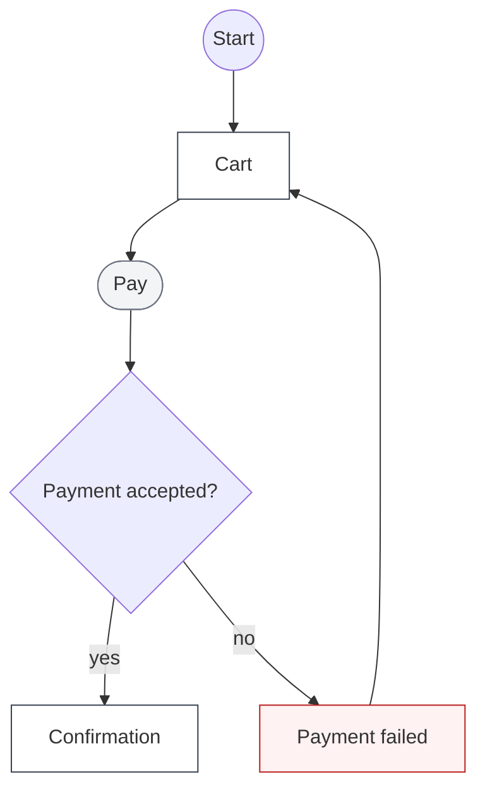
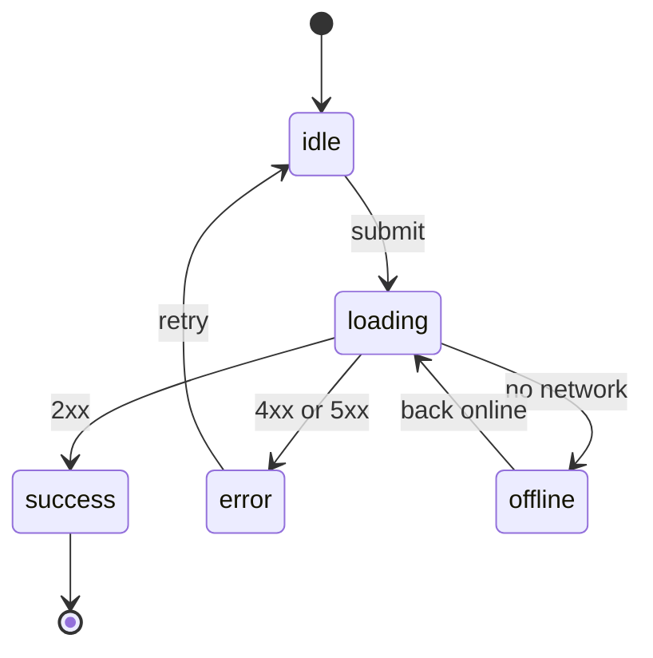
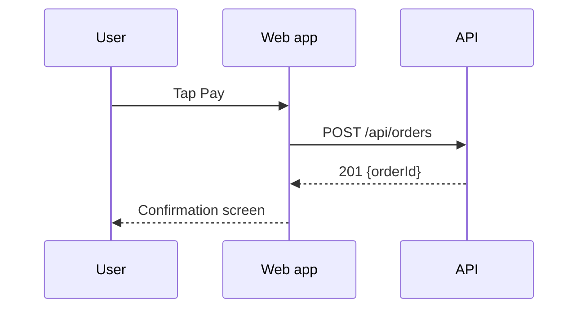

# Mermaid patterns

## Node shapes (fixed)

| Shape | Meaning |
|---|---|
| `((Start))` | Entry point |
| `[Screen]` | A screen or page |
| `{Decision?}` | A branch, written as a question |
| `([Action])` | A user or system action |
| `[[Sub-flow]]` | A flow drawn in its own diagram |

Keep every diagram to at most 20 nodes. Split anything larger into `[[Sub-flow]]` nodes, each
with its own diagram under its own heading.

## Shared classes

Start every flowchart with these lines so the diagrams look the same:

## State diagram

Add `empty` when a list or search can return nothing.

## Sequence diagram (only when a backend is called)

